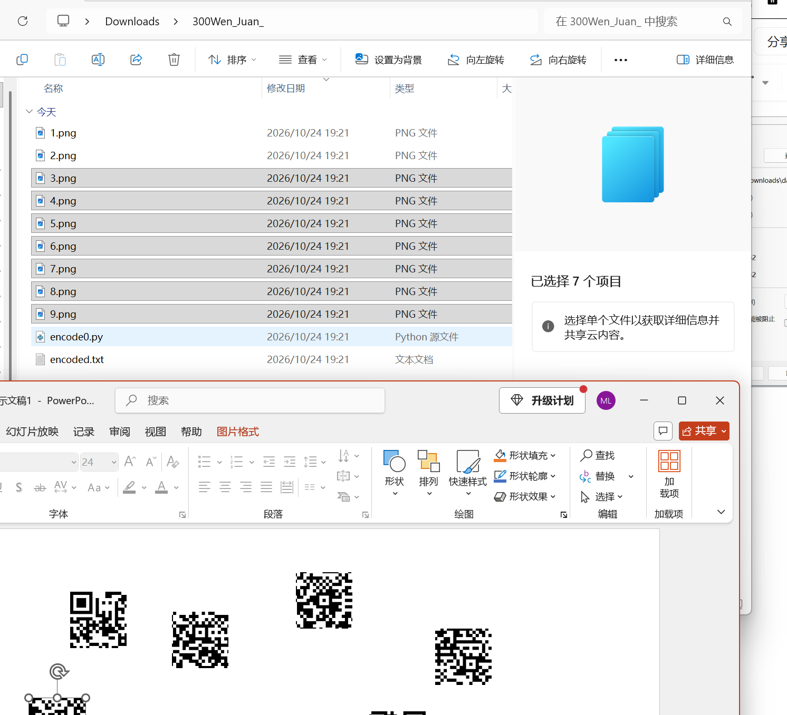
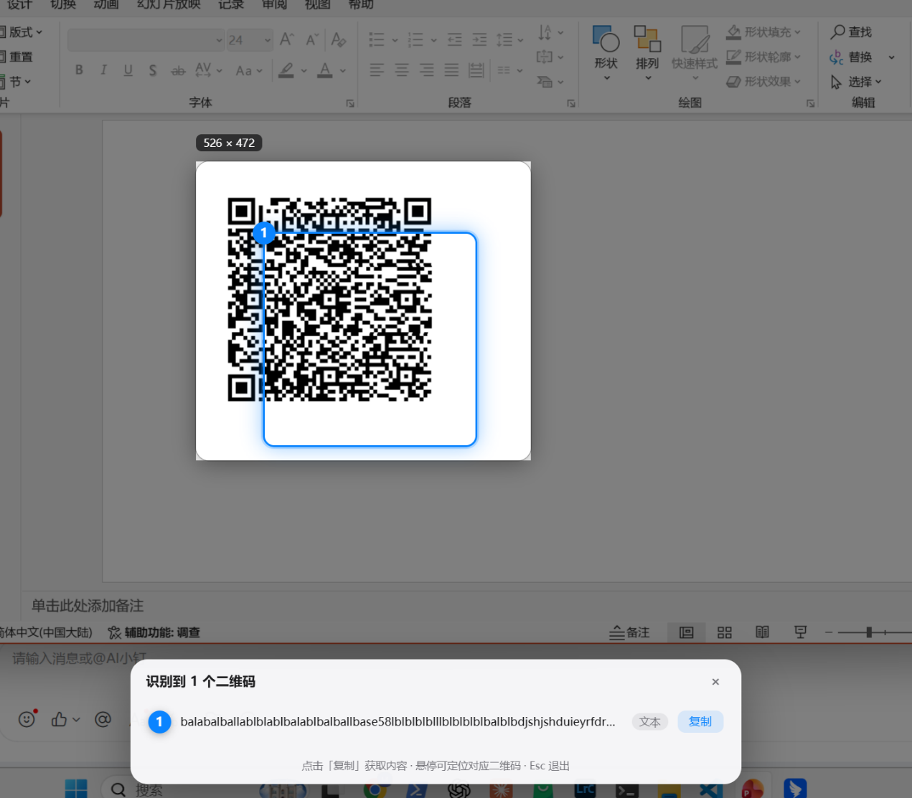

# At Least 300 Per Person

| | |
|---|---|
| **Event** | MoeCTF 2024 |
| **Category** | Misc — QR code |
| **Flag** | `moectf{we1rd_qrc0d3}` |

## Overview

The archive contains a large number of small image fragments — pieces of a QR code that has been cut apart.



The challenge name ("at least 300 per person") is a joke about the quantity of pieces.

## Solution

### 1. Reassemble the pieces

The fragments are not ordered, and no script was needed: dragging them onto a PowerPoint slide and arranging them by their edges was enough to rebuild the image.



### 2. Decode the QR code

Scanning the rebuilt code returns a deliberately noisy string that ends with a key:

```
...balabalballablblablbalablbalballbase58lblblblblllblblblblbalblbdjshjshduieyrfdrpieuufghdjhgfjhdsgfsjhdgfhjdsghjgfdshjgfhjdgfhgdh///key{3FgQG9ZFteHzw7W42}??
```

The `base58` mention and the `key{...}` section make `3FgQG9ZFteHzw7W42` the obvious candidate, so my first guess was:

```
moectf{3FgQG9ZFteHzw7W42}
```

That was rejected (`INCORRECT!`).


### 3. Read the challenge name instead

The challenge is titled *weird QR code* — the QR code itself is the point, not the Base58-looking text it decodes to. Submitting the title in flag format works:

```
moectf{we1rd_qrc0d3}
```

## Takeaways

- Not every string recovered from a challenge is the flag; the challenge name/description can be the intended answer.
- Physical reassembly is sometimes faster than writing an image-stitching script — a slide deck is a perfectly good tool.
- Watch for decoy text: the Base58 segment and the `key{...}` wrapper were designed to look like the answer.
