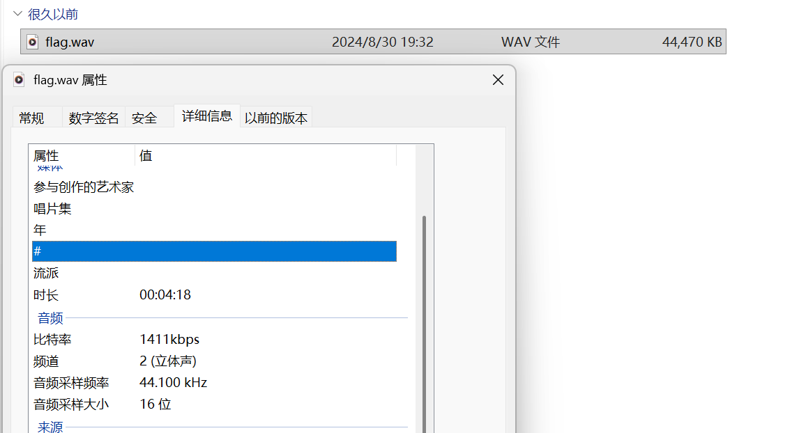
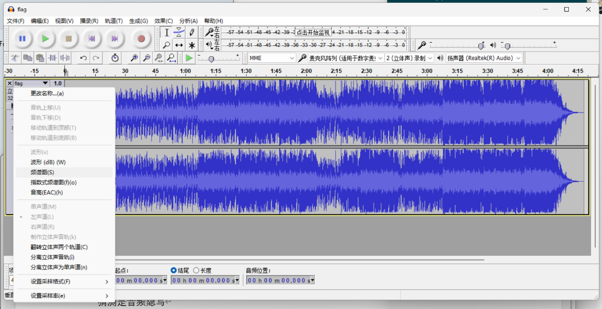
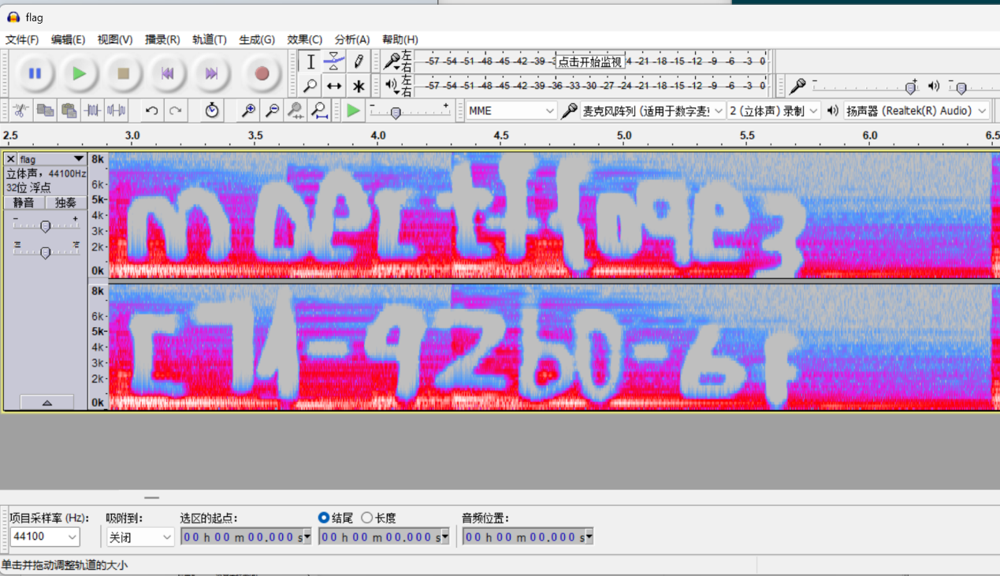
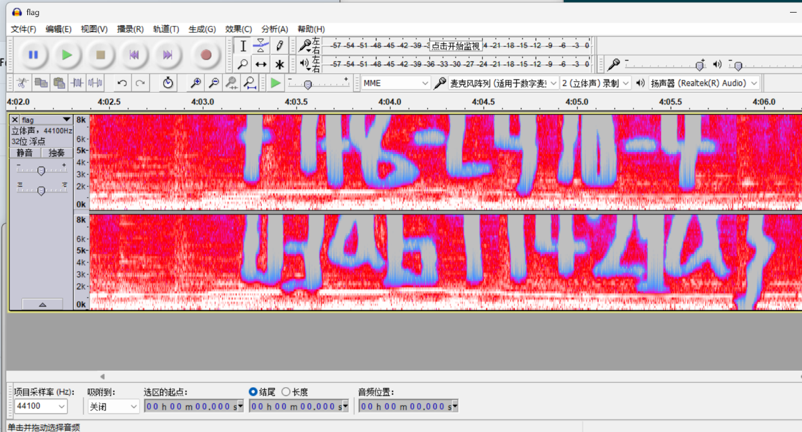
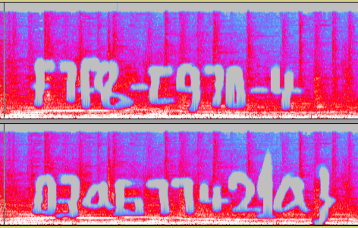
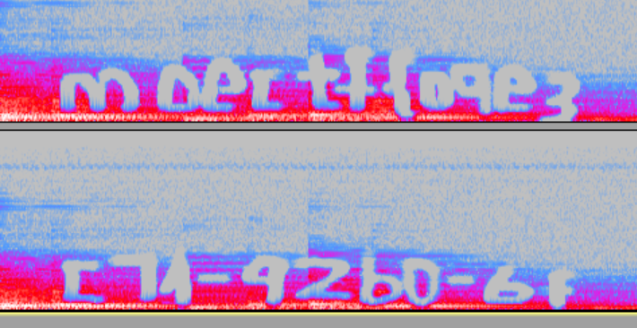

# Abnormal Lag

| | |
|---|---|
| **Event** | MoeCTF 2024 |
| **Category** | Misc — audio steganography |
| **Flag** | `moectf{09e3f7f8-c970-4c71-92b0-6f03a677421a}` |

## Overview

The attachment is an archive containing an audio file. Its properties look completely ordinary, so there is nothing useful in the metadata.



## Solution

The title points at the audio itself, and the file description mentions that the track stutters unnaturally at the beginning and at the end. That is a strong hint to look at the **spectrogram** rather than listen to it.

I opened the file in Audacity and switched the track view to Spectrogram.



The flag is drawn into the spectrogram, but only part of it is visible at the default zoom level:




My first reading was:

```
moectf{o9e3c71-92b0-6f+1+8-c910-403ab1142la}
```

That is not a valid flag — characters are clipped and the tail is wrong. Zooming out to fit the whole spectrogram showed the complete string:




```
moectf{09e3f7f8-c970-4c71-92b0-6f03a677421a}
```

## Takeaways

- Audio metadata being clean does not mean the audio is clean — check the spectrogram early.
- Spectrogram text is rendered at a fixed width; always zoom out until the entire selection is visible before reading, otherwise characters are cut off and the "flag" looks plausible but is wrong.
- The stuttering at both ends of the track was the deliberate hint telling us where to look.
