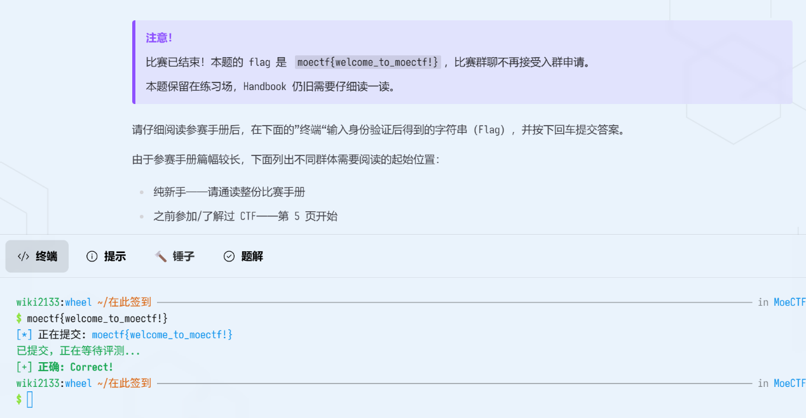

# Check-in

| | |
|---|---|
| **Event** | MoeCTF 2024 |
| **Category** | Misc |
| **Flag** | `moectf{welcome_to_moectf!}` |

## Overview

The warm-up challenge for MoeCTF 2024. The platform asks players to read the competition handbook and submit the string returned by the terminal — a classic "read the rules" check-in.

The challenge notice also states that, since the event is over, the flag for this task is published directly:

> `moectf{welcome_to_moectf!}`

## Solution

The terminal panel on the challenge page accepts the flag directly. Submitting it returns `Correct!`, which completes the challenge.

## Notes

Nothing technical here — the point is to confirm that the environment works and that the handbook has been read before moving on to the real challenges.
