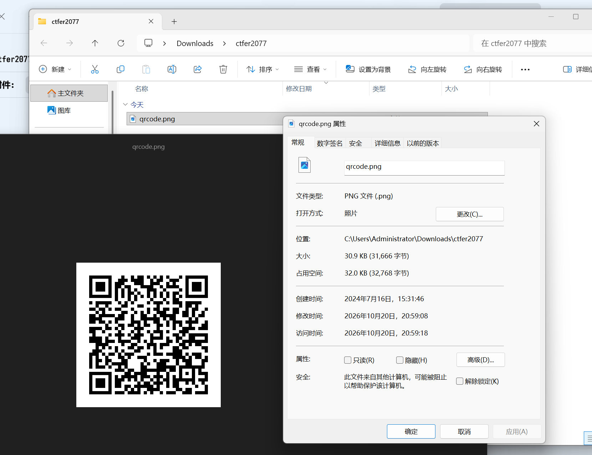
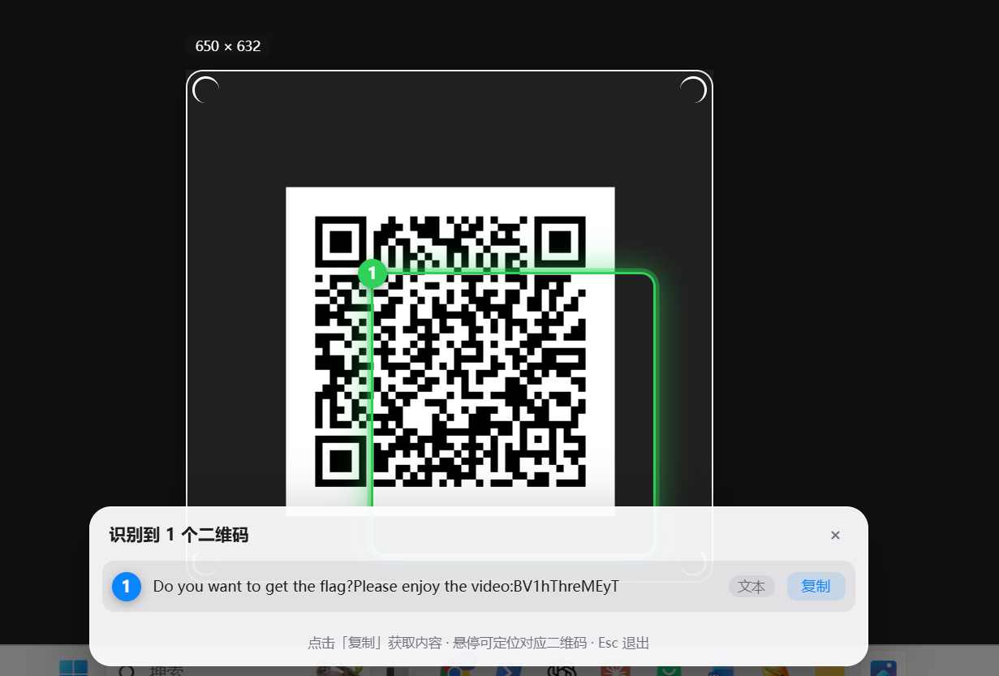
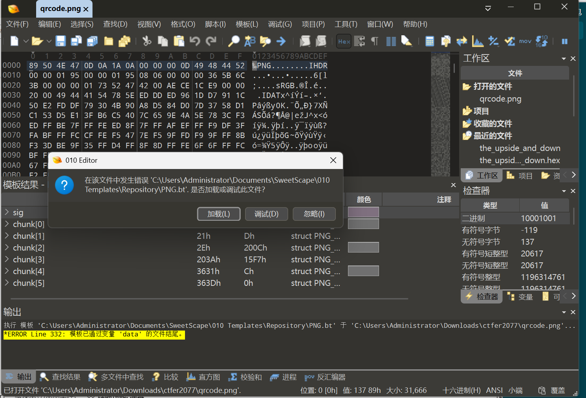
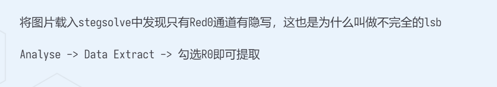
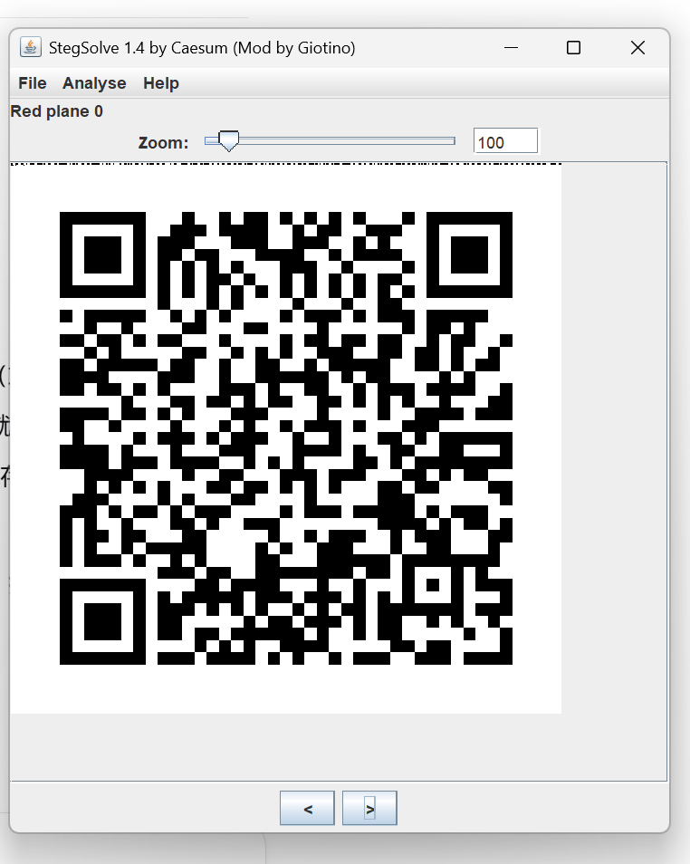
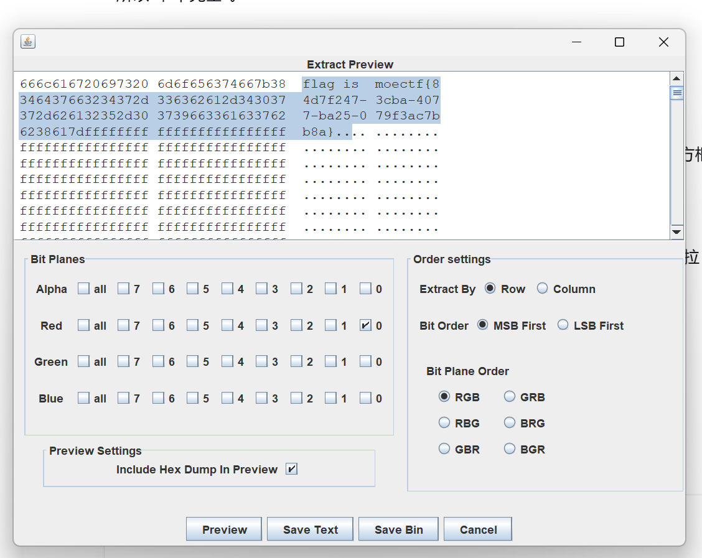

# ctf2077

| | |
|---|---|
| **Event** | MoeCTF 2024 |
| **Category** | Misc — image steganography |
| **Flag** | `moectf{84d7f247-3cba-4077-ba25-079f3ac7bb8a}` |

## Overview

The attachment is a PNG containing a QR code.



## Solution

### 1. Scan the QR code

Scanning it returns a hint: a Bilibili video ID beginning with `BV`. The challenge name, `ctf2077`, and the video reference suggest that the video contains the next step.

Searching Bilibili for that ID at the time of solving returned nothing — the video had already been taken down after the competition. A second file bundled with the challenge was the intended fallback.



### 2. Inspect the second image

Opening it normally shows nothing, and a plain hex inspection finds no embedded archive or appended data.




### 3. Split the colour channels

I loaded the image into **StegSolve** and cycled through the colour planes. With the **Red** channel set to 0, a distinct line of pixels appears that is invisible in the normal image.




Running StegSolve's **Analyse** function on that view extracts the hidden data:

```
moectf{84d7f247-3cba-4077-ba25-079f3ac7bb8a}
```

## Takeaways

- When a QR code leads to a dead link, look for a bundled fallback artifact — competition platforms sometimes leave the intended file in the attachment.
- Bit-plane / channel separation is still the first thing to try on a PNG that "looks normal" and has no appended data.
- In StegSolve, channel views such as *Red 0* and the Analyse tools are usually enough to expose LSB-style payloads.
