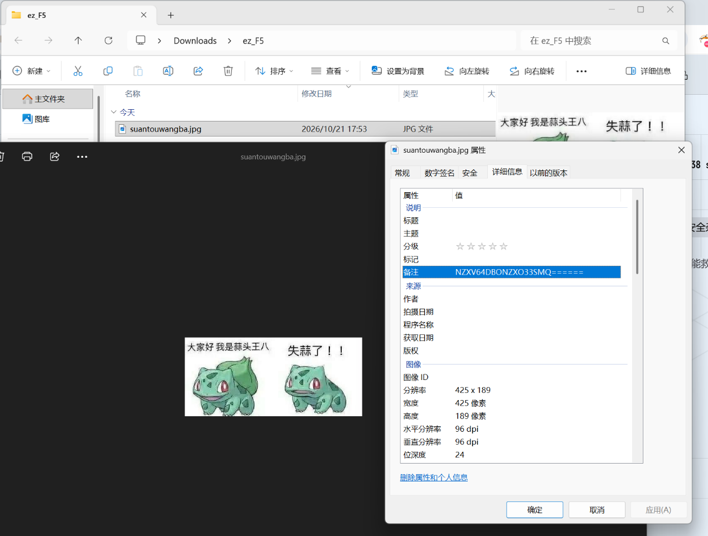
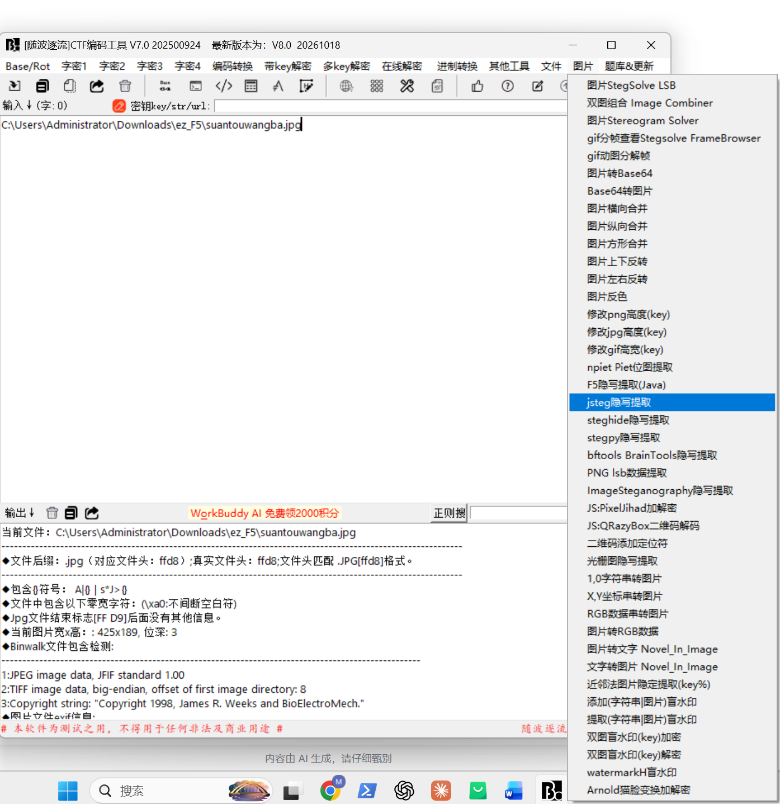
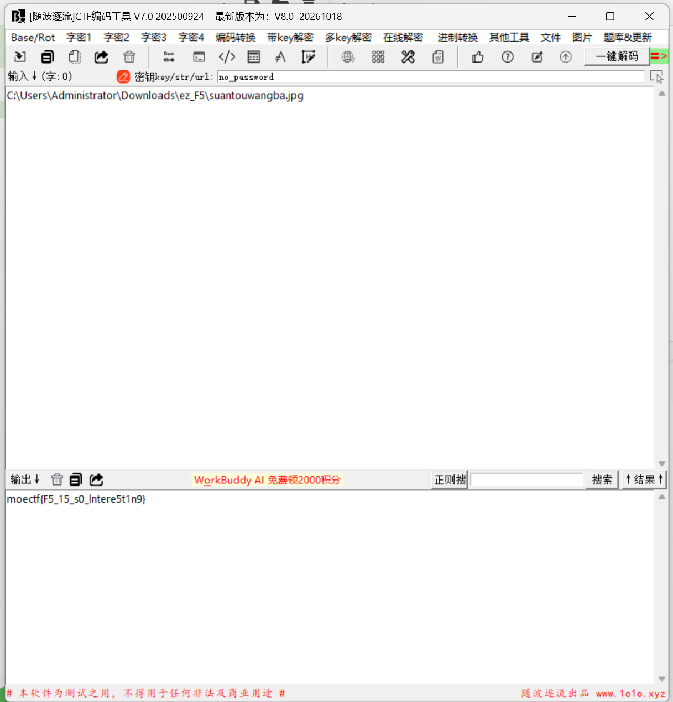

# ez_F5

| | |
|---|---|
| **Event** | MoeCTF 2024 |
| **Category** | Misc — JPEG steganography (F5) |
| **Flag** | `moectf{F5_15_s0_Intere5t1n9}` |

## Overview

The attachment is a JPEG image of a Pokémon joke (`suantouwangba.jpg`).



## Solution

### 1. Read the metadata

The file properties contain a suspicious value in the comment field:

```
NZXV64DBONZXO33SMQ======
```

The trailing `=` padding is characteristic of Base32. Decoding it in CyberChef gives:

```
no_password
```


So the "password" is literally `no_password`.

### 2. F5 extraction

The challenge hint names **F5** steganography. I used *Sui Bo Zhu Liu*, a Chinese all-in-one encoding/steganography GUI, which has a dedicated F5 extractor.



The first attempts returned nothing because the password field was left empty. After entering the decoded value `no_password`, the extractor produced the flag.



```
moectf{F5_15_s0_Intere5t1n9}
```

## Takeaways

- F5 stores its payload in the DCT coefficients of a JPEG, so it leaves no visible trace in the pixel data and is invisible to simple LSB tools.
- The metadata was not decorative: without the password the extractor silently returns nothing.
- Base32 padding (`=`) is a quick visual identifier; CyberChef handles it without any setup.
