# ez_Forensics

| | |
|---|---|
| **Event** | MoeCTF 2024 |
| **Category** | Misc — memory forensics |
| **Flag** | `moectf{WWBGY-TLVC5-XKYBZ}` |

## Overview

The archive contains a raw memory image (`flag.raw`), so this is a Windows memory forensics challenge.

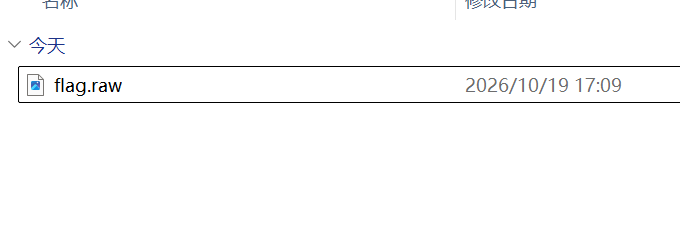

## Solution

### 1. Identify the image

Volatility 3 can identify the image with the `banners` plugin:

```bash
vol3.cmd -f flag.raw banners.Banners
```

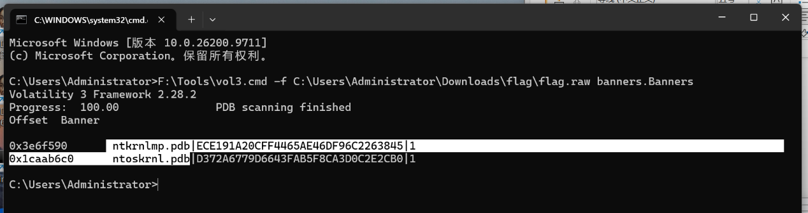

The result contains `ntkrnlmp.pdb`, which confirms a Windows kernel memory image. `windows.info` then reports the version: **Windows 7 SP1 x64**.

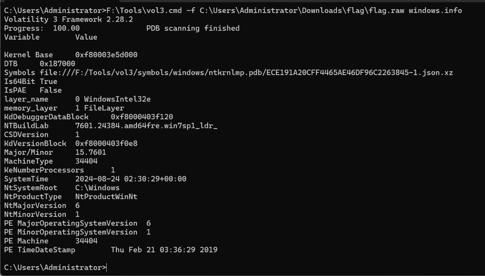

### 2. Enumerate processes

Walking the active process list (`windows.pslist`) shows the running processes and the parent/child structure.

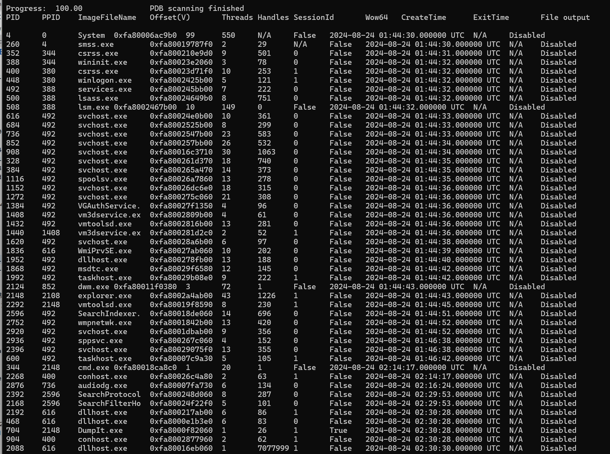
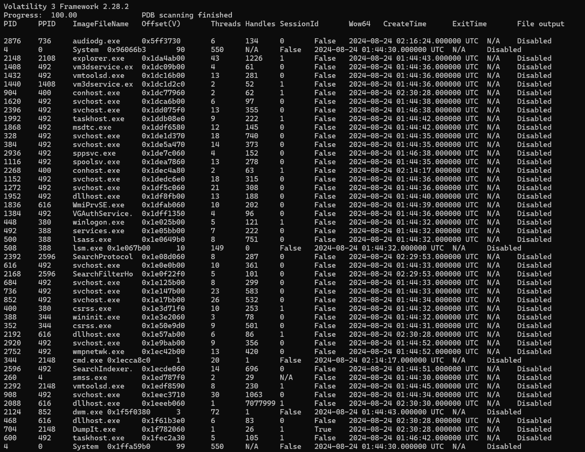

Among the system processes there is a `cmd.exe` spawned in an interactive session — that is the process the challenge author opened manually.

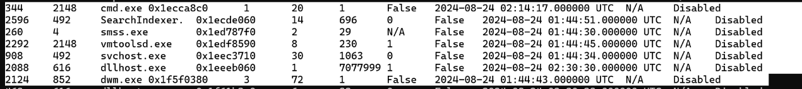
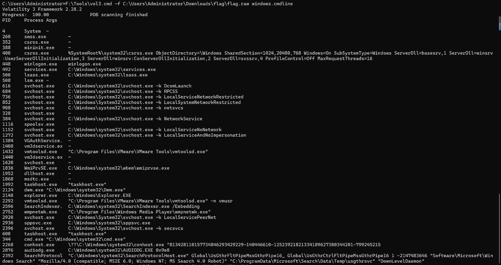
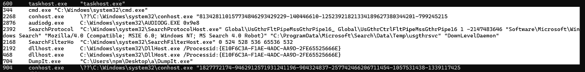

Its command line is empty, which means the commands were **typed into the console** instead of being passed as `/c ...`. The only place left to recover them is the console history buffer.

Other details visible in the process structures: the user name is `npm` and the desktop directory is `a`.

### 3. Network connections

`windows.netscan` shows only ordinary connections, nothing related to the flag.

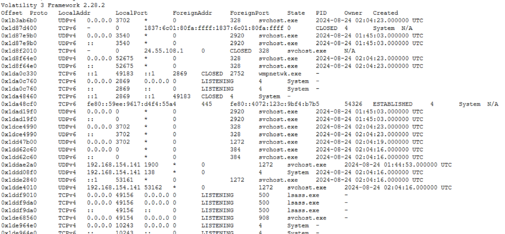

### 4. Recover the console history

The Volatility 3 `windows.consoles` plugin crashes on this Windows 7 image:

```
NotImplementedError: This version of Windows is not supported: 6.1.15.7601
```

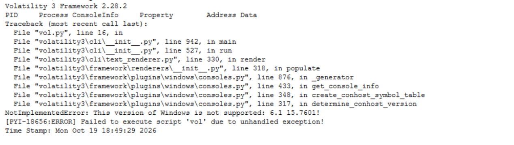

So I switched to Volatility 2.6, whose `consoles` plugin still supports Windows 7:

```bash
volatility -f flag.raw --profile=Win7SP1x64 consoles
```

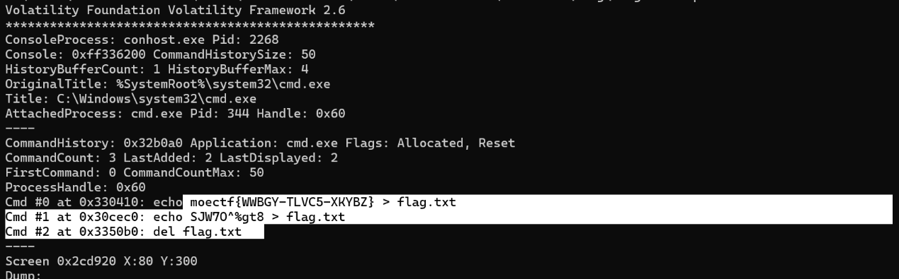

The command history buffer contains the entire story:

```
Cmd #0 at 0x330410: echo moectf{WWBGY-TLVC5-XKYBZ} > flag.txt
Cmd #1 at 0x30cec0: echo SJW70%g$t8 > flag.txt
Cmd #2 at 0x3350b0: del flag.txt
```

The author wrote the flag to a file, overwrote it with a decoy, and then deleted it. The flag itself is still in the console history.

## Flag

```
moectf{WWBGY-TLVC5-XKYBZ}
```

## Takeaways

- `banners.Banners` is the fastest way to decide which memory profile to use.
- A `cmd.exe` with an empty command line means interactive input — look at console buffers, not the process command line.
- Volatility 3 drops support for very old Windows builds on some plugins; having Volatility 2 installed as a fallback is still useful for Windows 7 images.
- Deleted files are not the only artifact: the command that created them often survives in the console history.
