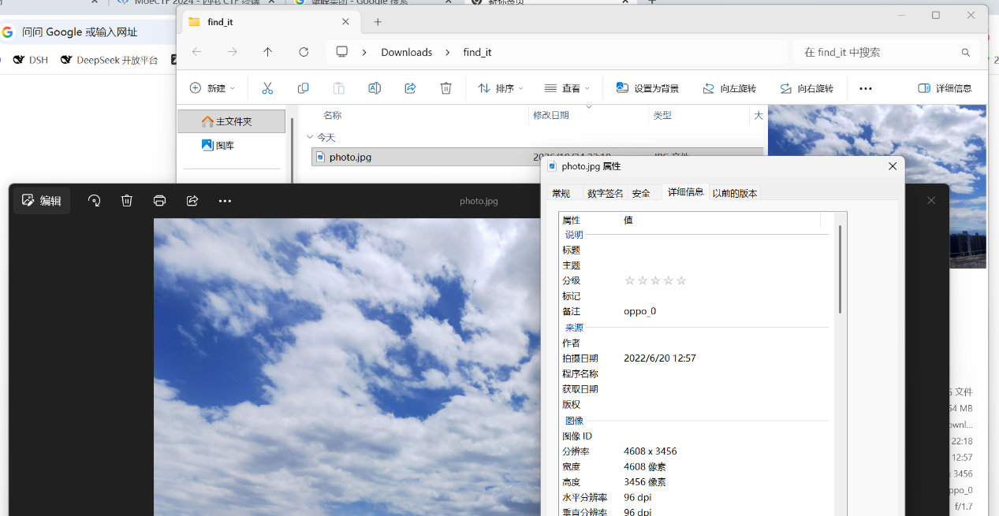
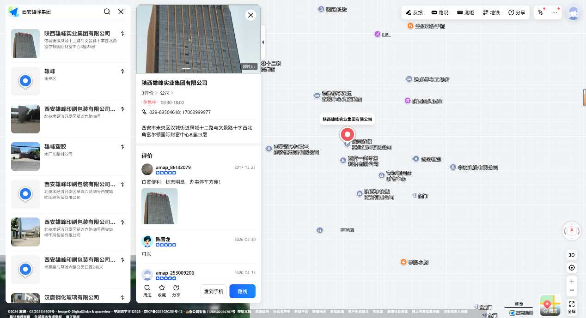
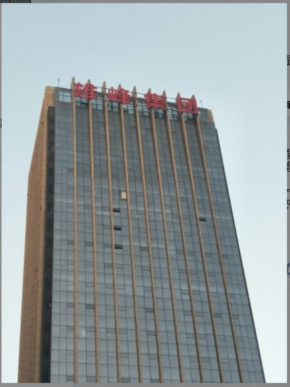
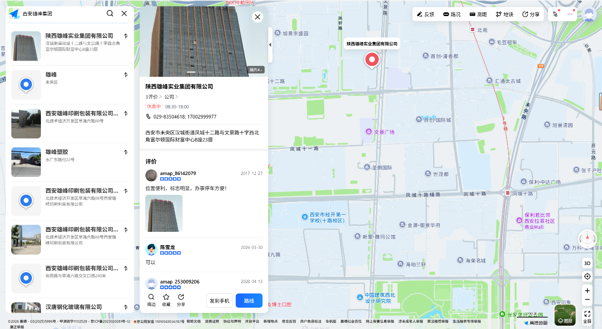
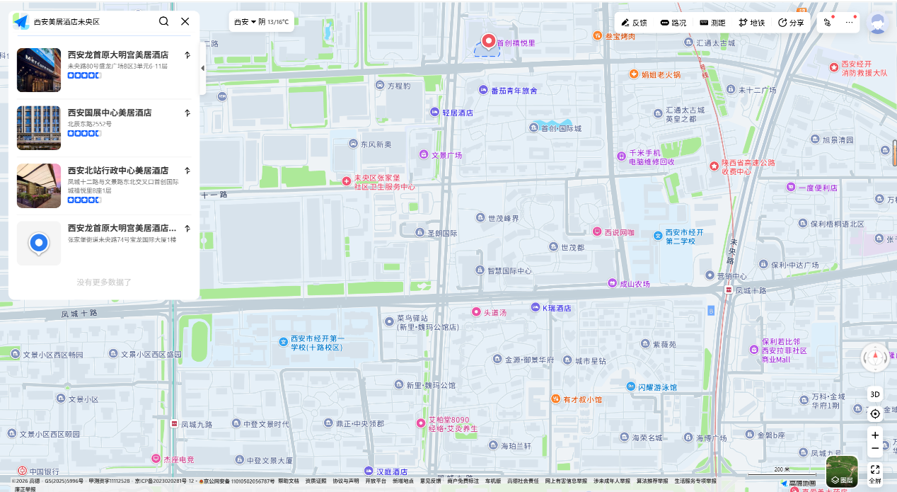
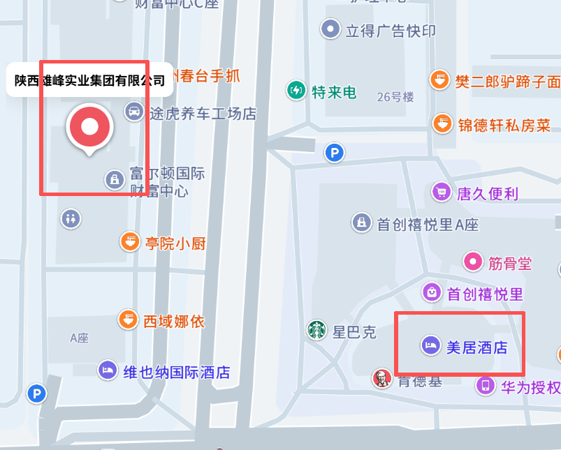
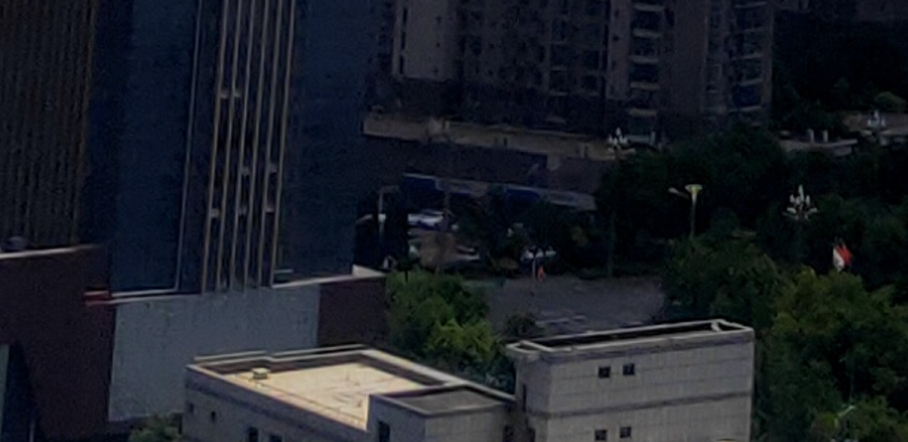
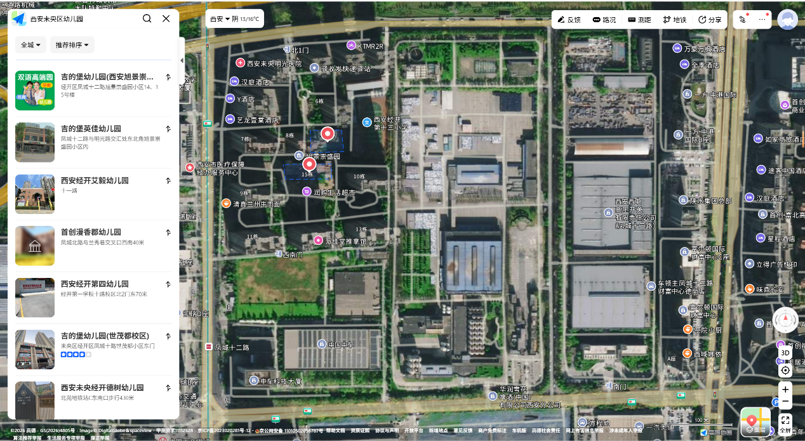

# Find It

| | |
|---|---|
| **Event** | MoeCTF 2024 |
| **Category** | Misc — OSINT / geolocation |
| **Flag** | `moectf{ji_di_bao_you_er_yuan}` |

## Overview

The challenge provides a single photograph and asks for the location where it was taken. The target city is Xi'an.



## Solution

### 1. Extract visible landmarks

Only two signs in the photo are legible:

- **Xiongfeng Group**
- **Mercure Hotel**

The hint points to Amap, so I searched for the two businesses together. One block matched the arrangement in the photo very closely.



### 2. Work out the camera orientation

Chinese residential buildings are oriented south-facing. That means the two high-rise towers visible in the screenshot should be **south-east of the camera position** — which fixes the direction the photographer was facing.






The shadow lengths at noon provided an independent check, and both lines of reasoning agreed on the same spot.



### 3. Narrow down the intersection

There is a crossroads in the frame, so the position must be in the **north-west quadrant of the intersection of Wenjing Road and Fengcheng 12th Road**.



The matching building is **Kid Castle Kindergarten**:

```
jidebaoyoueryuan
```

My first submission, `moectf{jidebaoyoueryuan_jidebaoyoueryuan}`, was rejected — the pinyin needs word separators. The accepted flag is:

```
moectf{ji_di_bao_you_er_yuan}
```

## Takeaways

- Two independent lines of evidence (building orientation and shadow direction) are much stronger than one; use both before submitting.
- Business signs are the highest-value clue in urban geolocation challenges — search the combination, not each name alone.
- Follow the flag format exactly: Chinese pinyin answers usually need underscores between syllables.
