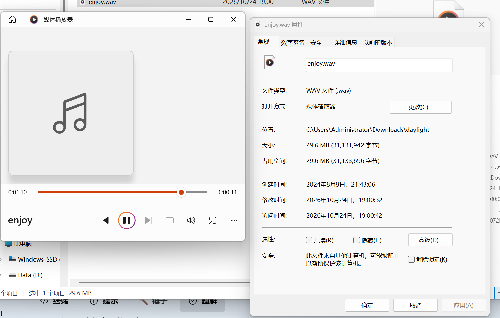

# Hold One Ear

| | |
|---|---|
| **Event** | MoeCTF 2024 |
| **Category** | Misc — audio |
| **Flag** | `moectf{NEVERGETUP}` |

## Overview

The attachment is a WAV file, `enjoy.wav` (29.6 MB, about 1 minute 10 seconds). There is nothing unusual in its properties.



## Solution

Listening to the track normally reveals nothing, but at the very end a sequence of numbers is spoken clearly:

```
63 31 43 31 41 52 31 51 71 101
```

The challenge description jokes that one hand is covering an ear while the other is "rubbing the keyboard until it catches fire". Combined with the hints:

- the numbers are related to **keyboard coordinates**;
- the author "accidentally pressed Caps Lock".

Mapping the numbers to key positions on the keyboard, with Caps Lock enabled, spells out:

```
NEVERGETUP
```

Hence the flag:

```
moectf{NEVERGETUP}
```

## Takeaways

- Audio challenges often hide data in speech rather than in the waveform; listen to the tail of the track first.
- When a challenge mentions a keyboard, the digits are usually positions, not values — the Caps Lock hint tells you which case to use.
