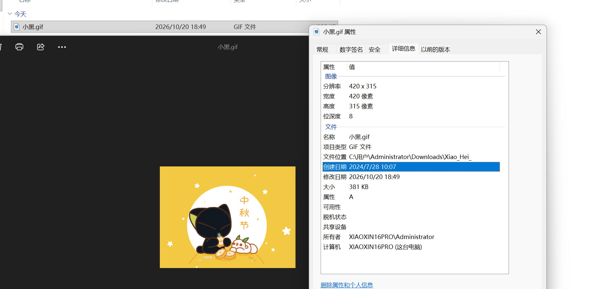
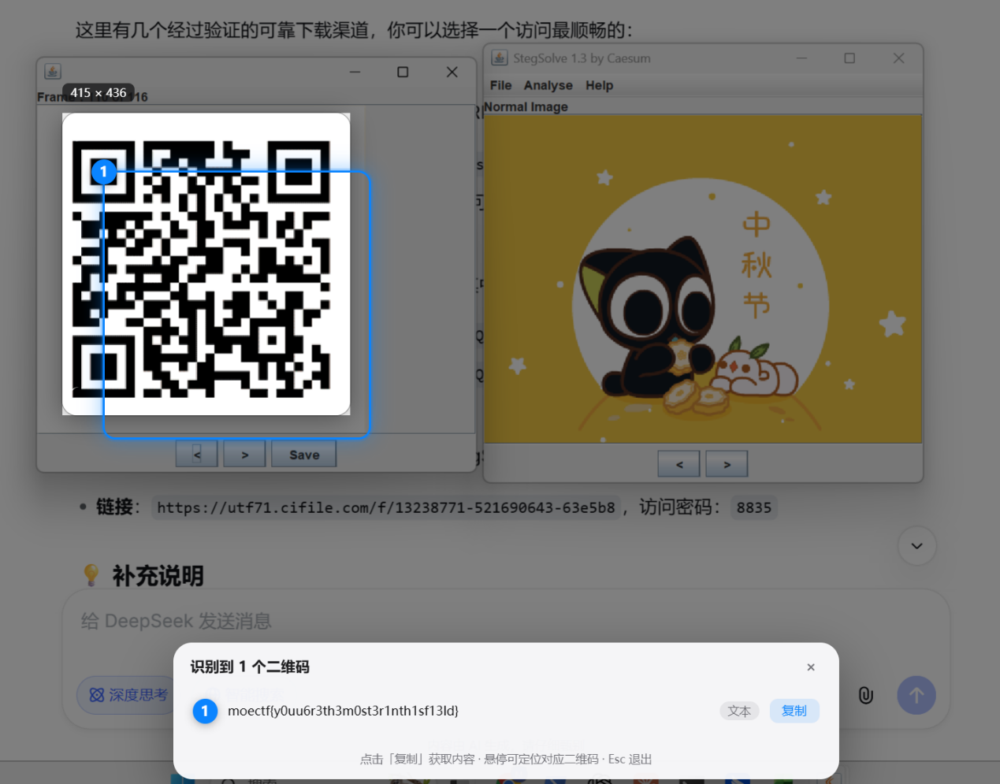

# Luo Xiaohei

| | |
|---|---|
| **Event** | MoeCTF 2024 |
| **Category** | Misc — image steganography |
| **Flag** | `moectf{y0uu6r3th3m0st3r1nth1sf13ld}` |

## Overview

The attachment is an animated GIF (420×315).



Playing it normally shows nothing suspicious — just a short animation.


The challenge hint states that this is an image steganography problem, so the payload is hidden inside the frames rather than in the animation itself.

## Solution

I opened the GIF in **StegSolve** and stepped through it frame by frame instead of viewing it as an animation. One of the frames contains a QR code that never appears during normal playback.



Scanning the QR code gives:

```
moectf{y0uu6r3th3m0st3r1nth1sf13ld}
```

## Takeaways

- For GIFs, always check individual frames — a viewer only shows the composited animation, and a single frame can carry a completely different image.
- StegSolve's frame browser is enough for this class of challenge; no scripting is required.
