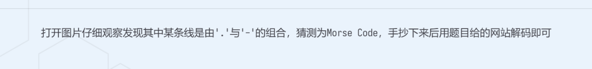
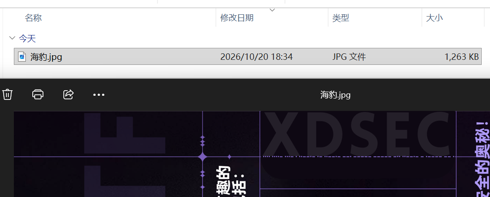
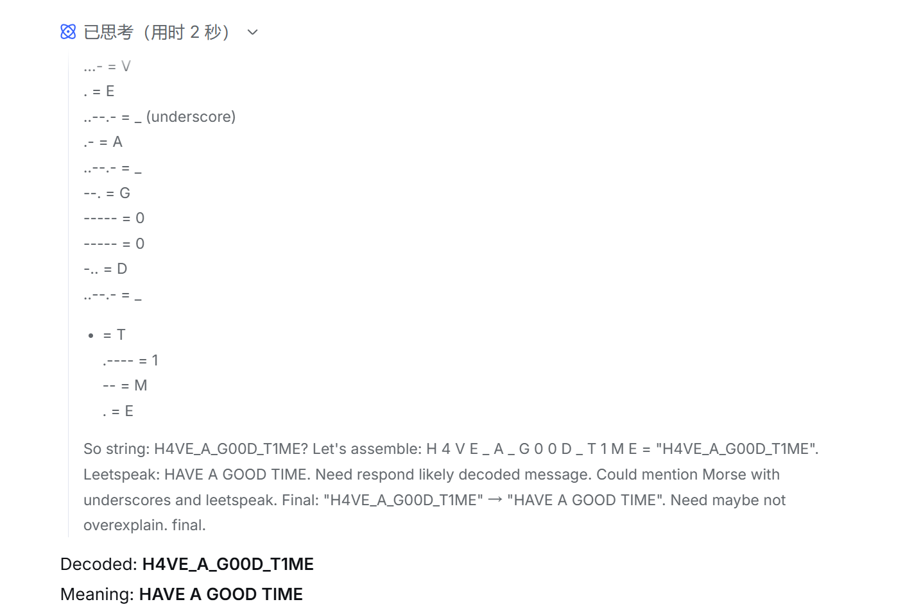

# Misc Primer

| | |
|---|---|
| **Event** | MoeCTF 2024 |
| **Category** | Misc — encoding |
| **Flag** | `moectf{H4VE_A_G00D_T1ME}` |

## Overview

The beginner's guide challenge for the Misc category. The description contains a long string of dots and dashes:

```
.... ....- ...- . ..--.- .- ..--.- --. ----- ----- -.. ..--.- - .---- -- .
```




## Solution

The character set (` . ` and `-`) and the grouping into five-symbol blocks make this an obvious Morse code challenge.

Decoding each group:

| Morse | Plain |
|---|---|
| `....` | H |
| `....-` | 4 |
| `...-` | V |
| `.` | E |
| `..--.-` | _ |
| `.-` | A |
| `..--.-` | _ |
| `--.` | G |
| `-----` | 0 |
| `-----` | 0 |
| `-..` | D |
| `..--.-` | _ |
| `-` | T |
| `.----` | 1 |
| `--` | M |
| `.` | E |

Note that `..--.-` is the (non-standard but widely used) Morse extension for the underscore character `_`.

The decoded message is:

```
H4VE_A_G00D_T1ME
```



Wrapped in the event's flag format:

```
moectf{H4VE_A_G00D_T1ME}
```

## Takeaways

- Morse is usually recognisable immediately by its two-symbol alphabet and short groups.
- Watch for extended Morse codes such as `..--.-` (`_`) — the challenge flag format needs the separator, so a decoder that drops unknown symbols will not produce the right string.
