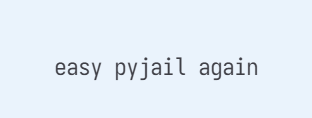
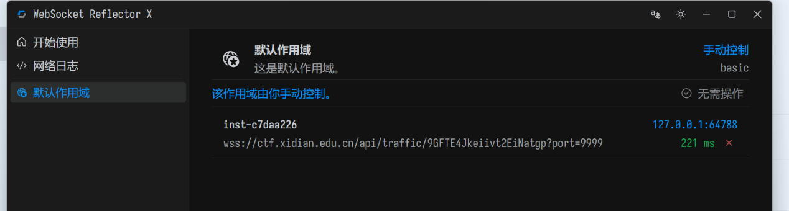

# moejail_lv2

| | |
|---|---|
| **Event** | MoeCTF 2024 |
| **Category** | Misc — Python jail |
| **Flag** | Not recorded in the source notes |

## Overview

The sequel to `moejail_lv1`, described on the challenge page as *easy pyjail again*.

## Status

The instance was started through WSRX, but the original solve log does not contain the payload or the resulting flag.

## Notes

The recorded material stops at instance setup, so no technical conclusion is claimed here. The writeup is kept in the repository for completeness rather than as a solution reference.
