# My Layer Is Above Yours

| | |
|---|---|
| **Event** | MoeCTF 2024 |
| **Category** | Misc — document steganography |
| **Flag** | `moectf{d751894b-ee0a-47dd-85d4-e92d0443921f}` |

## Overview

The attachment is a document with an embedded image and a nested archive. The archive is encrypted, and the password is hidden in the document's layered artwork.

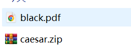
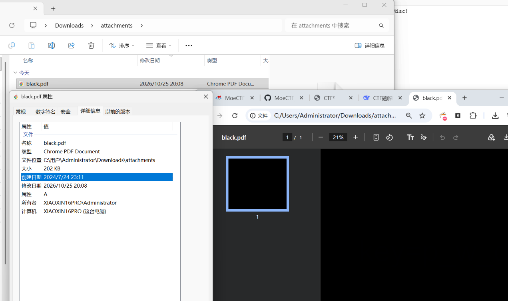

## Solution

### 1. Find the nested archive

Extracting the archive inside the attachment produces a second, password-protected archive.

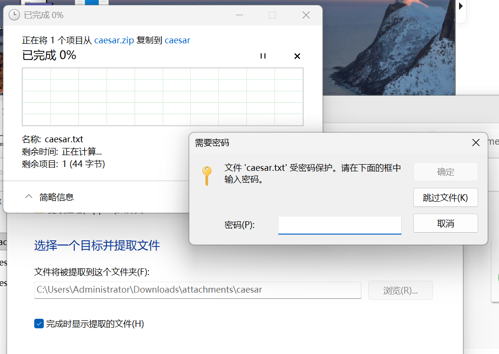

Trying to open it confirms that a password is required. The hint says the password is hidden in the PDF's layers, so the next step is to inspect the document itself.

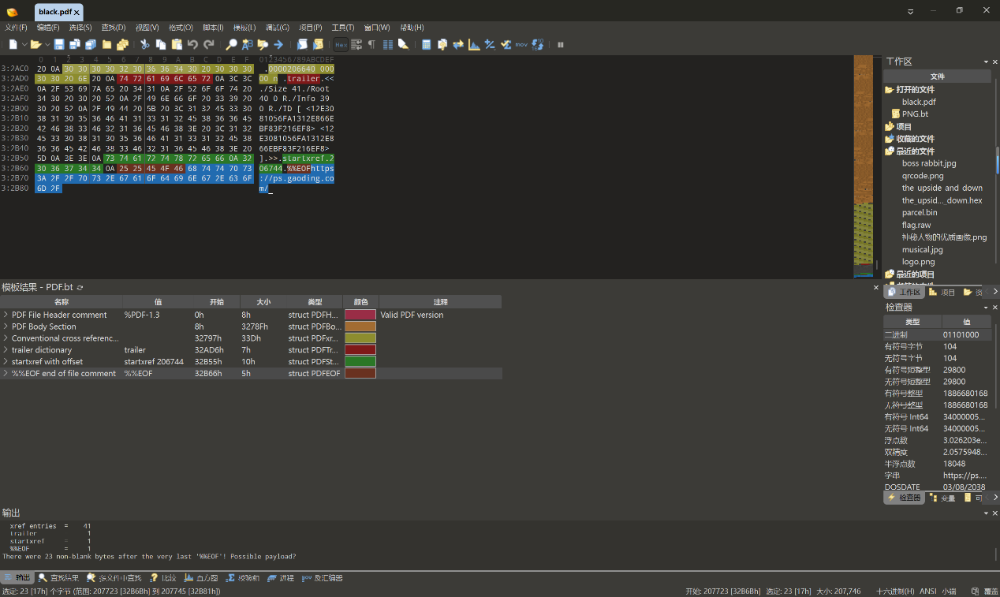

### 2. Discover the intended tool

Opening the file in **010 Editor** reveals a URL embedded in the document:

```
https://ps.gaoding.com/
```

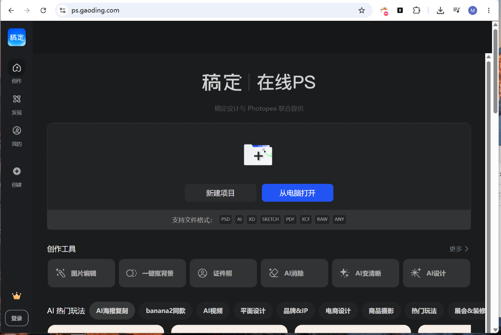

That is Gaoding's online Photoshop. Opening the site and loading the image shows that it is a layered design, not a flat bitmap.

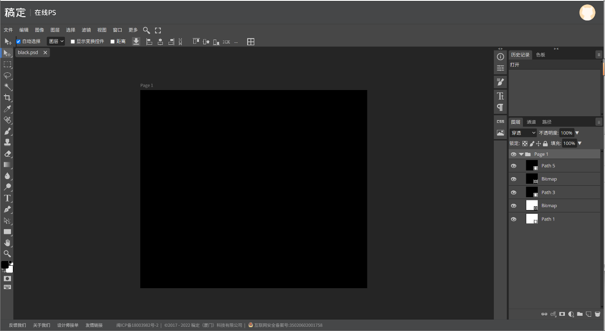

### 3. Isolate the two bitmap layers

The design contains five vector layers. The hint says to keep the two **bitmap** layers and merge them.

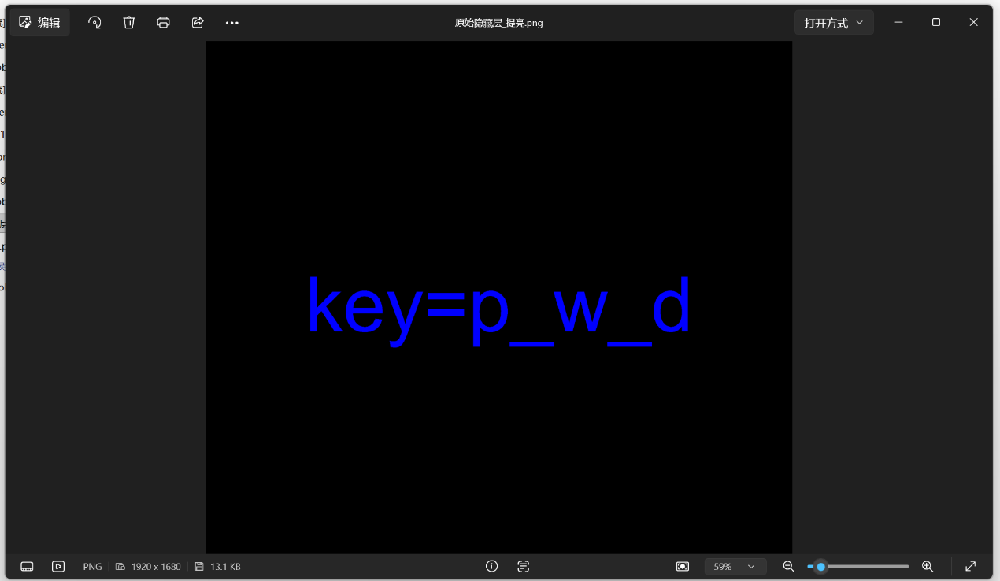

The two bitmap layers behave very differently:

- the white one contains exactly one colour, `(255, 255, 255)`, so it is effectively empty;
- the black one contains two colours, `(0, 0, 0)` and `(0, 0, 1)`.

The important detail is the blue channel value `1`, not `0`. A difference of 1/255 is below the threshold of human perception, so the image looks uniformly black.

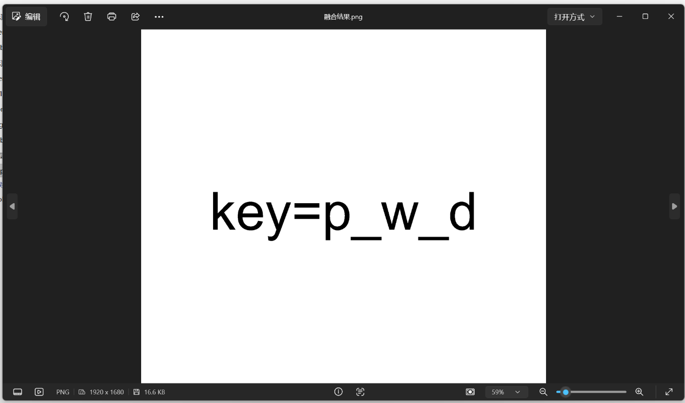
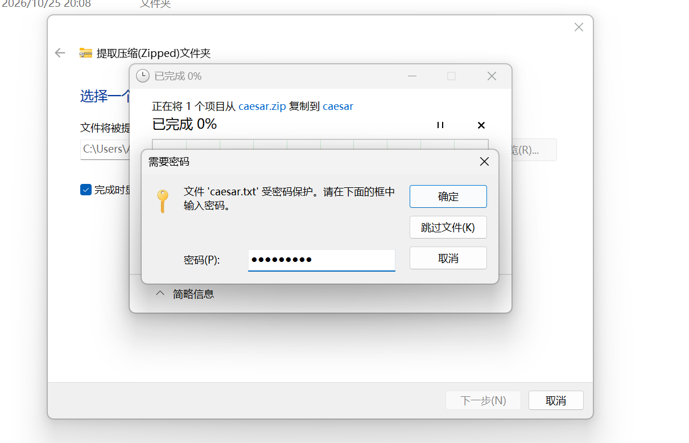

### 4. Amplify the hidden channel

Multiplying the blue channel by 255 maps the value `1` to full brightness. The dark text on the black background then becomes visible:

```
key=p_w_d
```

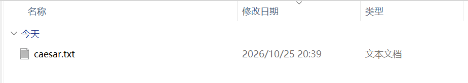
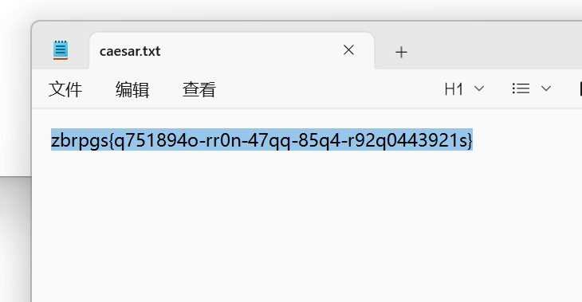

### 5. Decrypt the archive

The archive unlocks with `p_w_d`. Its contents look like an encoded ciphertext, so I ran them through CyberChef's decoders.

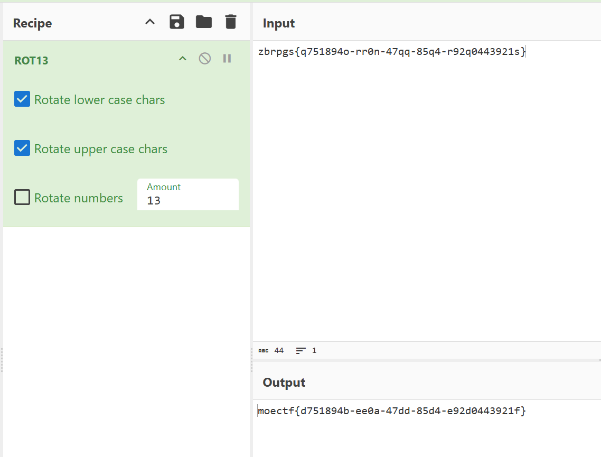

```
moectf{d751894b-ee0a-47dd-85d4-e92d0443921f}
```

## Takeaways

- "Invisible" does not mean "absent": a channel value of 1 is a legitimate bitmap colour and survives PNG compression.
- When a challenge mentions layers, treat the file as a design document and look for the editor that created it — the URL in the raw bytes was the direct pointer.
- Amplifying a single channel (multiply by 255) is the standard way to expose a 1-bit-per-channel payload.
