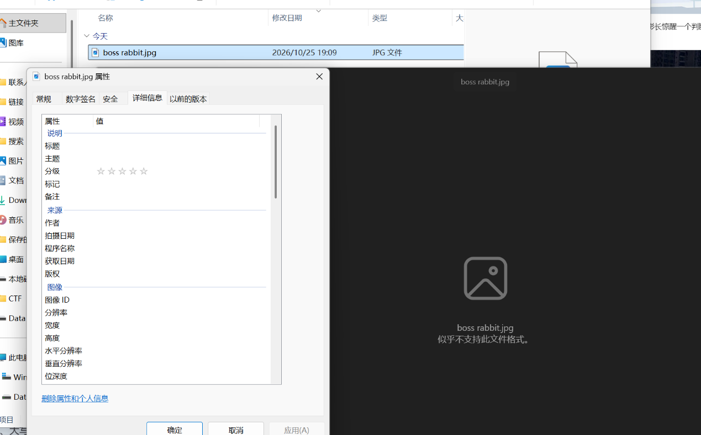
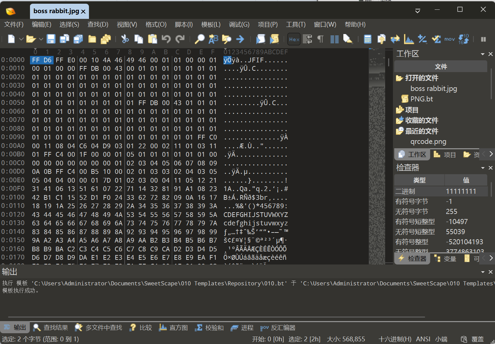
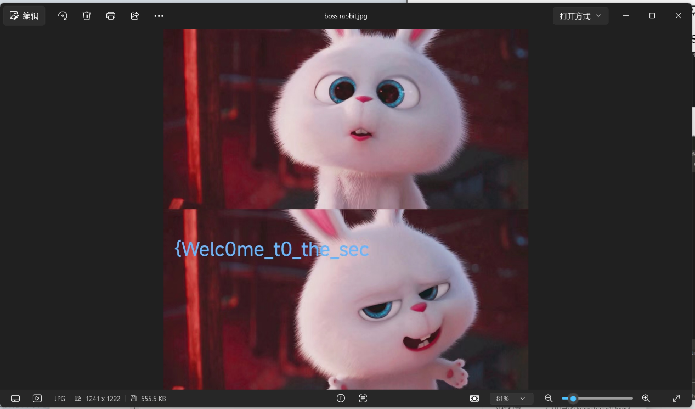
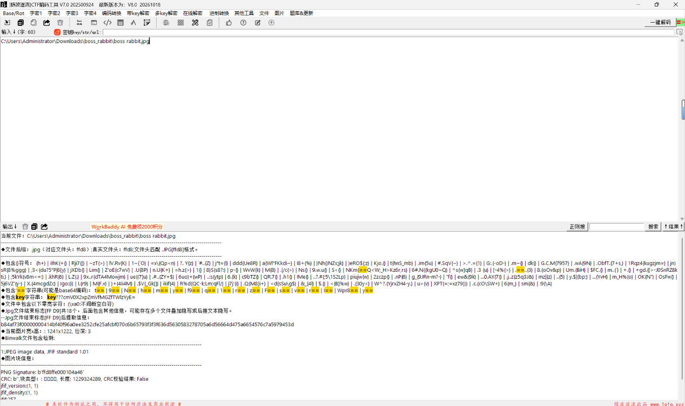
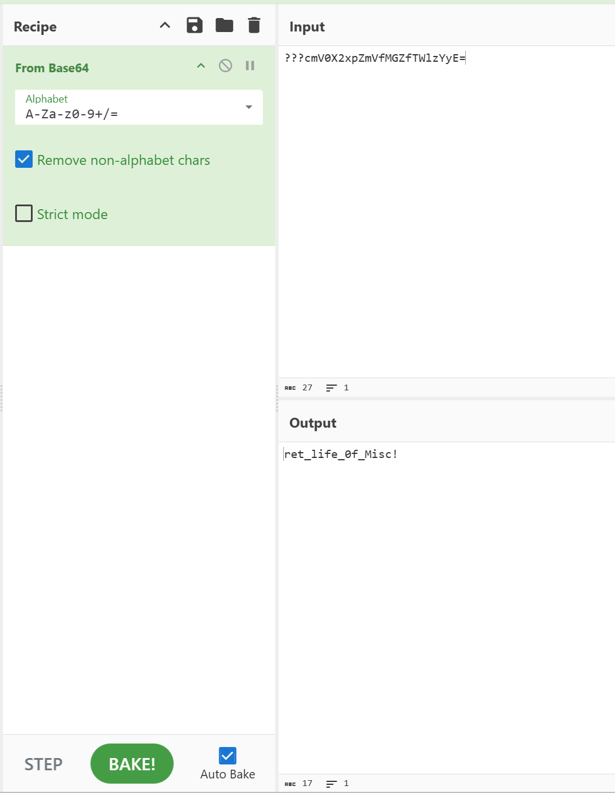

# the_secret_of_snowball

| | |
|---|---|
| **Event** | MoeCTF 2024 |
| **Category** | Misc — file repair + image steganography |
| **Flag** | `moectf{Welc0me_t0_the_secret_life_0f_Misc!}` |

## Overview

The attachment is `boss rabbit.jpg`. It looks like an ordinary image, but Windows cannot open it, and the file properties contain nothing useful.



## Solution

### 1. Repair the JPEG header

Opening the file in **010 Editor** shows that it starts with the bytes `FF D6`.

A valid JPEG must start with `FF D8`. Changing the first two bytes to `FF D8` repairs the file.




The repaired image now opens and shows the first half of the flag:

```
{Welc0me_t0_the_sec
```



### 2. Extract the second half

The hint says the remaining part is hidden with Base64. Running the image through CyberChef's *From Base64* operation (after extracting the appended data) yields:

```
ret_life_0f_Misc!}
```



Combining both halves:

```
moectf{Welc0me_t0_the_secret_life_0f_Misc!}
```

## Takeaways

- Two-byte header corruption is a classic "broken file" challenge; compare the first bytes against the expected signature before assuming the file is encrypted.
- `FF D8 FF` is the start of a JPEG; `FF D6` is not a valid marker in that position.
- Flags are often split across two independent techniques — repair the container first, then extract the payload.
