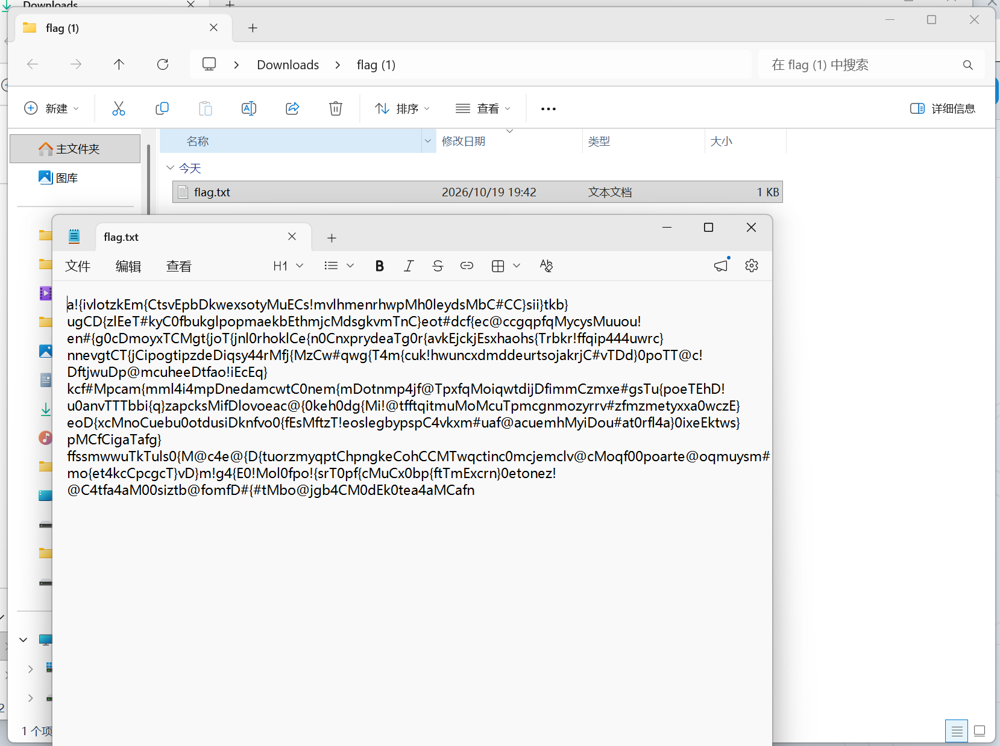
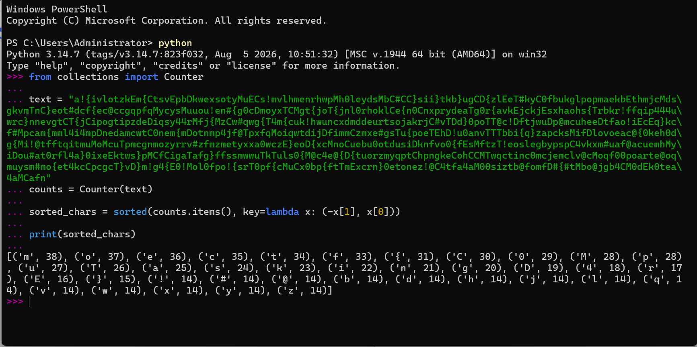

# So Many 'm'

| | |
|---|---|
| **Event** | MoeCTF 2024 |
| **Category** | Misc |
| **Flag** | `moectf{c0MpuTaskingD4rE}` |

## Overview

The attachment is a folder containing a single `flag.txt`.



Opening it shows pages of seemingly random characters rather than a readable string.



## Solution

The challenge title is the hint: the text is dominated by the letter `m`. Treating the file as a corpus and counting character frequencies turns the noise into a signal — the distribution encodes the real message.

After the frequency analysis the flag is:

```
moectf{c0MpuTaskingD4rE}
```

## Takeaways

- When a "flag file" looks like garbage, ask what property of the text could carry information: length, character set, ordering, or frequency.
- The challenge name is often the strongest hint. "So many 'm'" told us exactly which statistic mattered.
