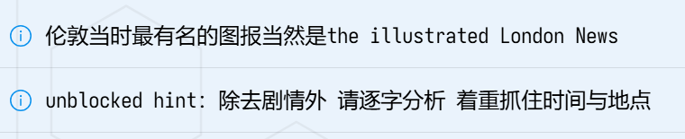
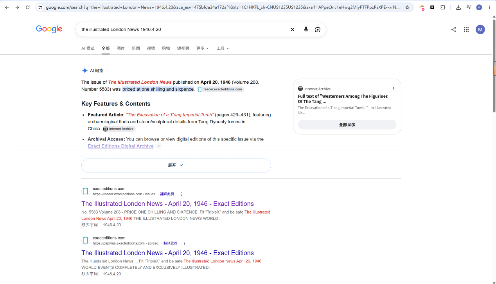
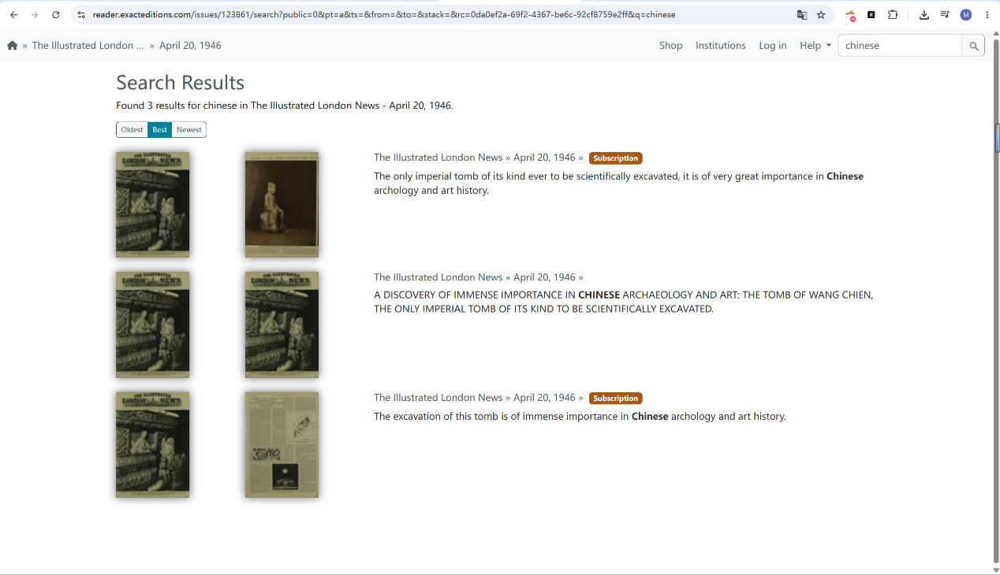
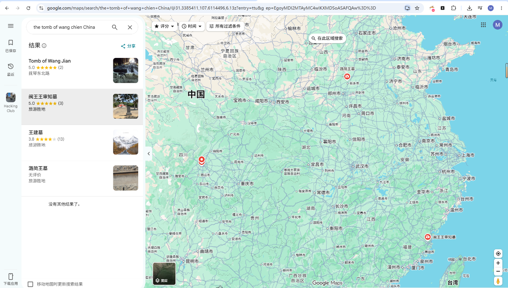
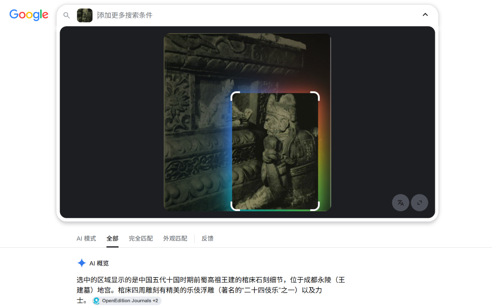
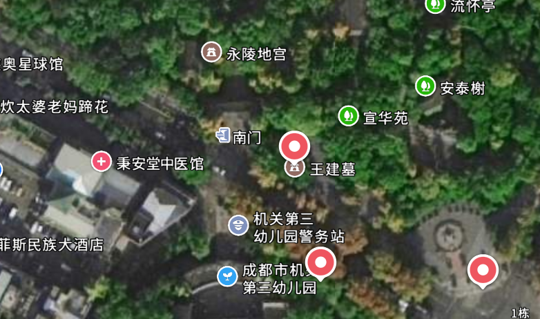
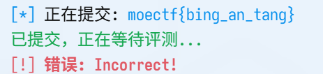
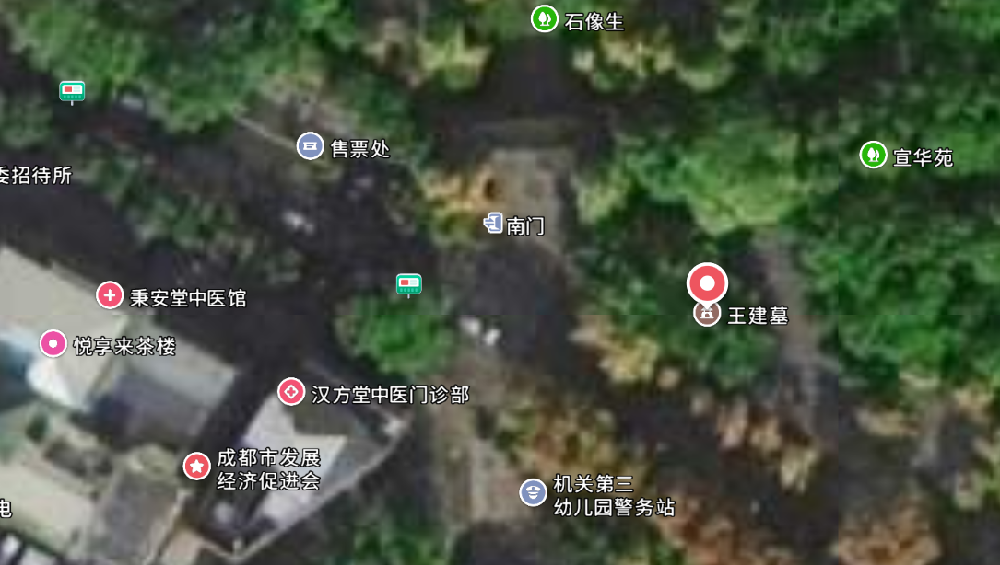

# Time Machine

| | |
|---|---|
| **Event** | MoeCTF 2024 |
| **Category** | Misc — OSINT |
| **Flag** | `moectf{han_fang_tang}` |

## Overview

An OSINT challenge built around a historical photo and a nearby location.



The hint is simply: *notice the hint*.

## Solution

### 1. Identify the landmark

Entering the clue into a search engine leads to **Wang Jian's tomb** (the Yongling Museum) in Chengdu.





The modern map around the tomb confirms the layout.




### 2. Identify the building

Zooming in on the map shows two traditional-medicine pharmacies in the area, so there is ambiguity. My first guess was:

```
moectf{bing_an_tang}
```

That was rejected.




Trying the second one:

```
moectf{han_fang_tang}
```

This is the accepted flag.

## Takeaways

- When a map shows two plausible candidates, submit both — the checker distinguishes them.
- The pinyin spelling matters: flags use the standard pinyin of the business name, with underscores between syllables.
- "Notice the hint" usually means the hint is embedded in the image itself, not in the challenge text.
