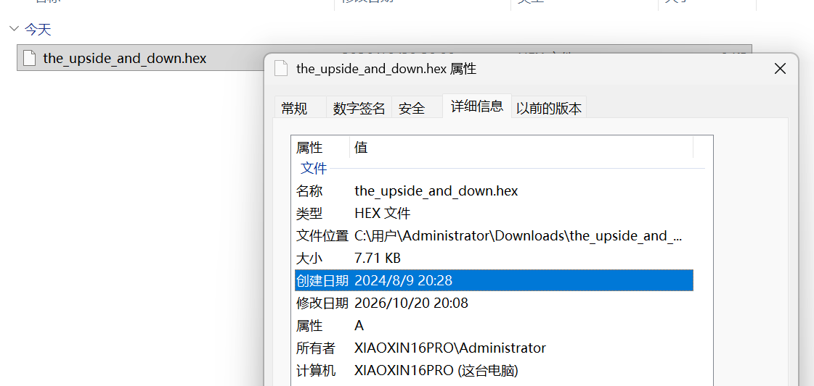
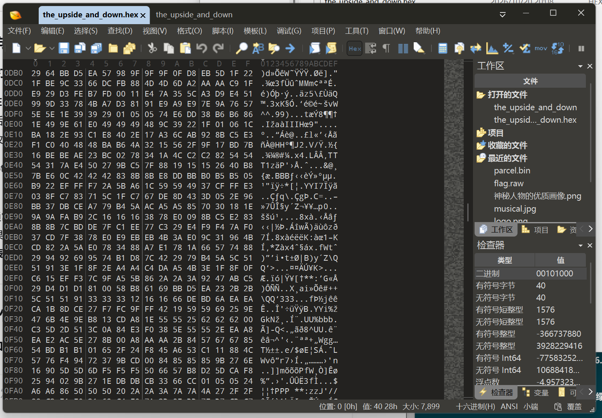
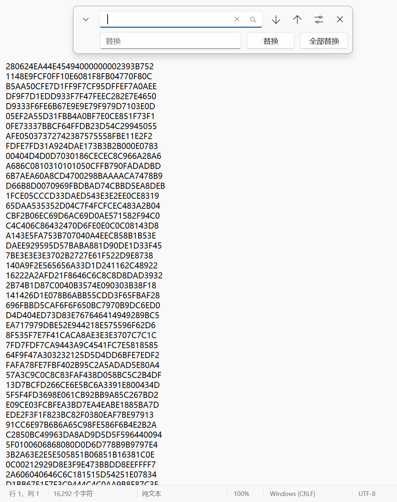
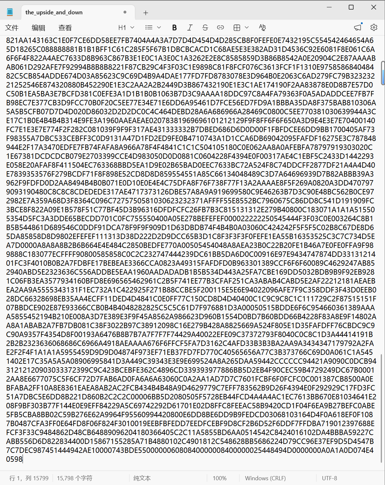
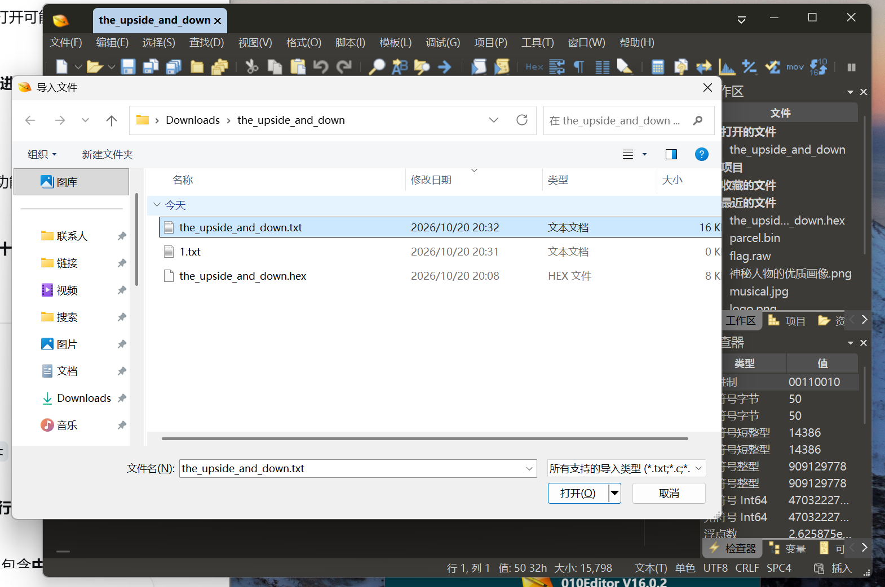
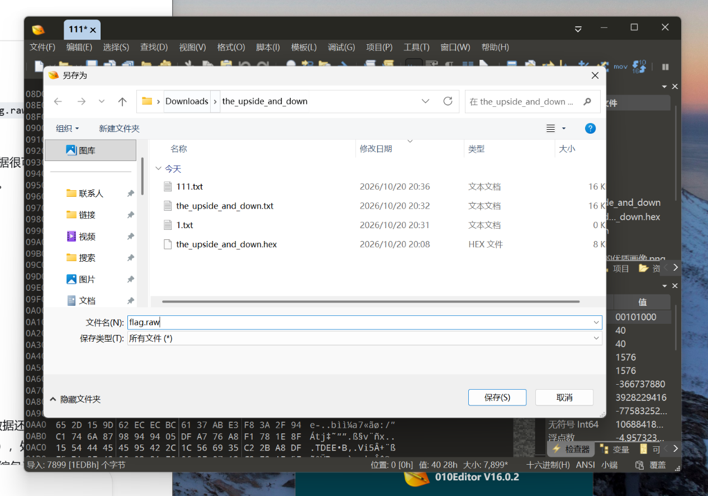
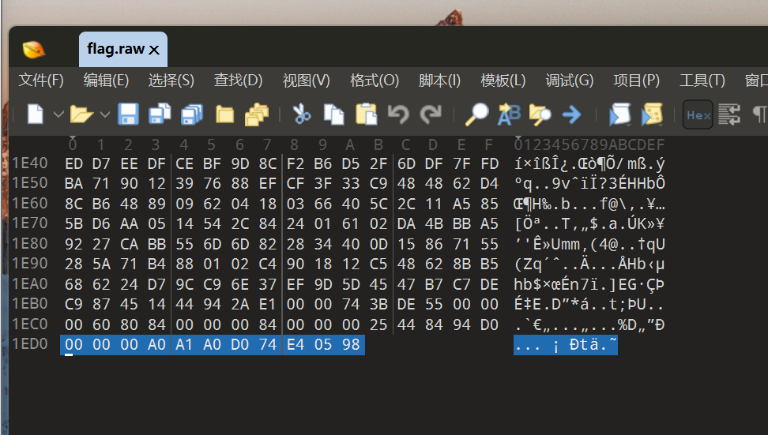

# The Upside and Down

| | |
|---|---|
| **Event** | MoeCTF 2024 |
| **Category** | Misc — file format |
| **Flag** | `moectf{Fri3nds_d0n't_lie!}` |

## Overview

The attachment looks like a small, unremarkable file with no obvious structure.



## Solution

### 1. Inspect the raw bytes

Opening the file in **010 Editor** shows only text-like data — there is no recognisable binary header.



Exporting the bytes as text and opening the result in Notepad confirms the same thing: a long run of characters with spaces.



### 2. Clean up the text

Removing the spaces:



Removing the line breaks:



Re-importing the cleaned text as binary still did not produce a valid file.




### 3. Notice the reversed header

After checking common file signatures, the key observation was the **end** of the file: its trailing bytes (`05 98 …`) mirror the beginning of a known file header. Combined with the challenge name, *The Upside and Down*, this means the whole file is stored **backwards**.



Reversing the file with Python is enough:

```python
data = open("challenge.bin", "rb").read()
open("recovered.png", "wb").write(data[::-1])
```


The reversed bytes form a valid PNG:


Reading the image gives the flag:

```
moectf{Fri3nds_d0n't_lie!}
```

## Takeaways

- If a file has no valid header, check whether the **tail** contains a signature — a reversed file is a common trick, and the challenge title often says so outright.
- Text editors are a poor way to edit binary data; work byte-wise with a hex editor or a short script.
- `data[::-1]` is the whole exploit once the transformation is identified.
