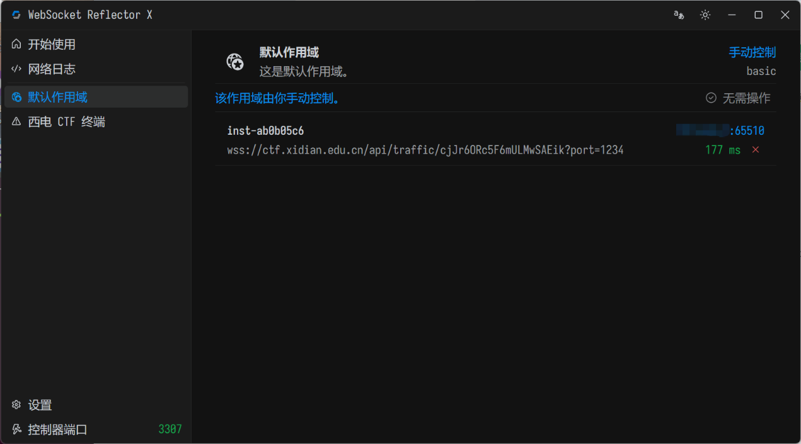
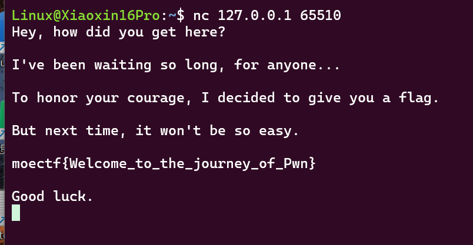

# Binary Exploitation Primer

| | |
|---|---|
| **Event** | MoeCTF 2024 |
| **Category** | Pwn |
| **Flag** | `moectf{Welcome_to_the_journey_of_Pwn}` |

## Overview

The introductory Pwn challenge: a remote service that hands out the flag once you connect to it with netcat.



## Solution

1. Read the instance address and port from the challenge page.

2. Connect from a Linux machine (or WSL):

   ```bash
   nc <host> <port>
   ```

3. The service prints the flag immediately:

   

```
moectf{Welcome_to_the_journey_of_Pwn}
```

## Takeaways

- This challenge is purely about confirming that the toolchain works: an instance address, a port, and `nc`.
- Getting this working early matters — every later Pwn challenge depends on being able to reach a remote service and interact with it.
