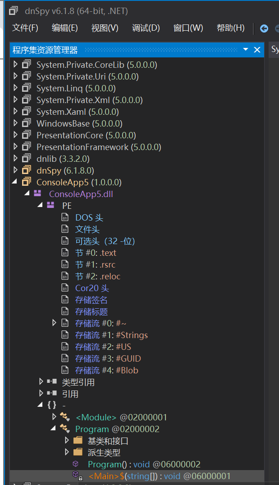
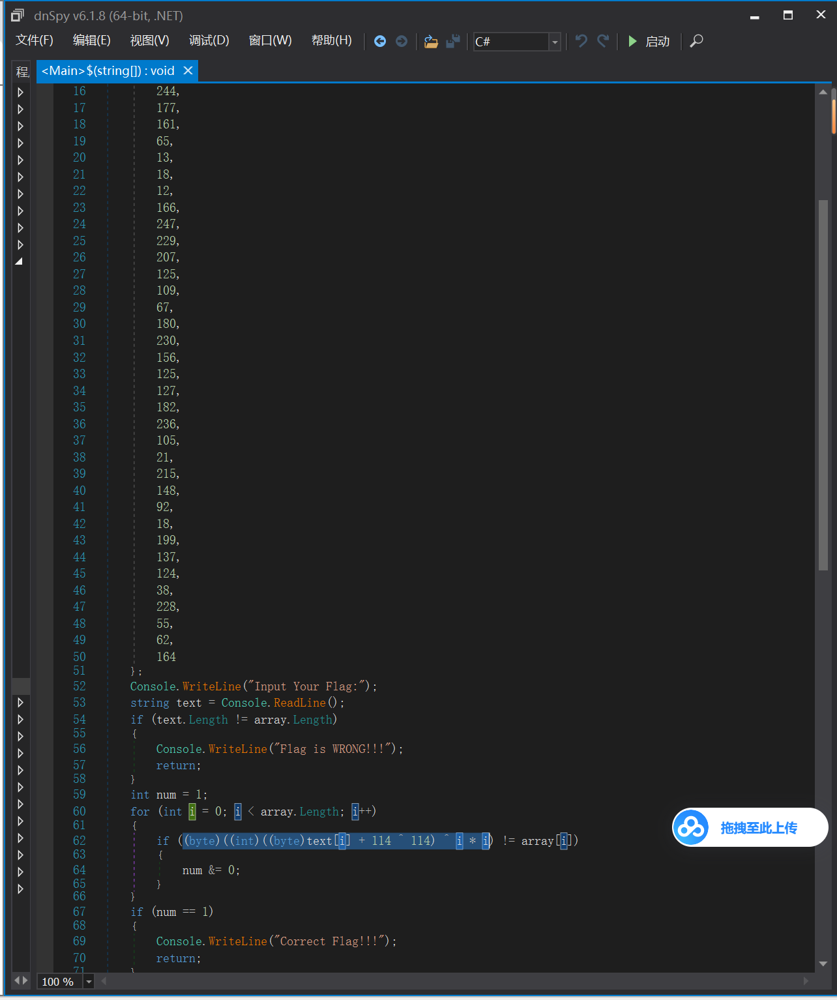
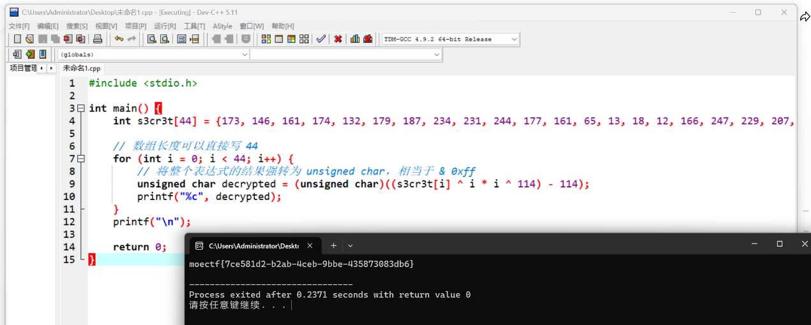

# d0tN3t

| | |
|---|---|
| **Event** | MoeCTF 2024 |
| **Category** | Reverse engineering — .NET |
| **Flag** | `moectf{7ce581d2-b2ab-4ceb-9bbe-435873083db6}` |

## Overview

A .NET assembly. The hint suggests using **dnSpy** or **ILSpy** to decompile it.

## Solution

Opening the binary in dnSpy and navigating to `Main` shows the full verification logic in C#:




The core transformation is:

```csharp
(byte)((int)((byte)text[i] + 114 ^ 114) ^ i * i)
```

Read left to right, each input byte is:

1. incremented by `114`;
2. XORed with `114`;
3. XORed with `i * i`.

## Reversing it

XOR is its own inverse, so the decryption routine applies the same operations in reverse order:

```c
for (int i = 0; i < 44; i++) {
    unsigned char decrypted =
        (unsigned char)((s3cr3t[i] ^ i * i ^ 114) - 114);
    printf("%c", decrypted);
}
```



```
moectf{7ce581d2-b2ab-4ceb-9bbe-435873083db6}
```

## Takeaways

- .NET binaries decompile almost perfectly — dnSpy recovers readable C# with variable names and control flow intact.
- When a transformation is a chain of invertible byte operations, undo it in reverse order; `+114` becomes `-114` at the end.
- The `i * i` term couples each byte to its position, so the decryption loop must preserve the index.
