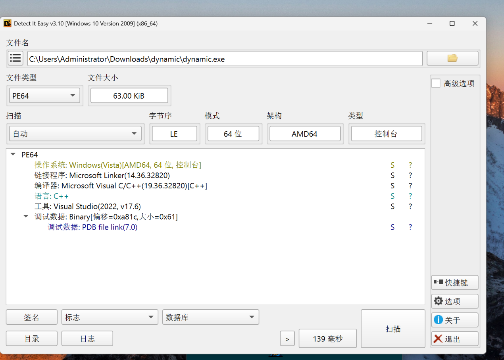
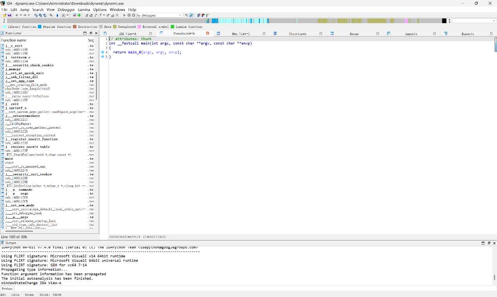

# dynamic

| | |
|---|---|
| **Event** | MoeCTF 2024 |
| **Category** | Reverse engineering |
| **Flag** | Not recorded in the source notes |

## Overview

The attachment is a Windows console executable, `dynamic.exe`.

## Reconnaissance

### File identification

*Detect It Easy* reports:

- format: `PE64`
- compiler: Microsoft Visual C++ (19.36.32080), C++
- architecture: AMD64, console subsystem
- debug data: PDB file `link`

There is no packer or protector signature, so the binary can be analysed directly without unpacking.



### Entry point

Loading the binary into IDA and decompiling shows a very small `main` that just forwards to `main_0`:

```c
int __fastcall main(int argc, const char **argv, const char **envp)
{
  return main_0(argc, argv, envp);
}
```



## Status

The recorded solve log stops after locating `main_0`; the flag and the internal logic are not included in the original notes.

## Notes

The binary is a conventional MSVC console program with an extra `main_0` wrapper — the same shape produced when a program uses `main` plus an internal entry function (or a static-library wrapper). The next step would be to analyse `main_0` and follow its string/constant references.
