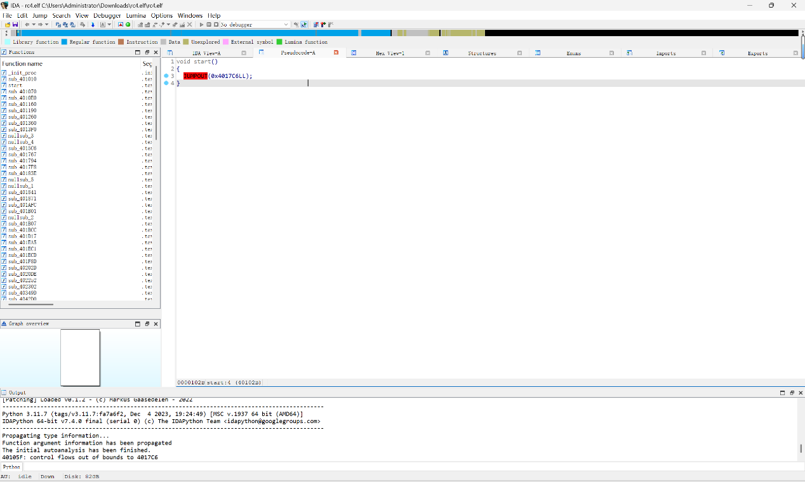
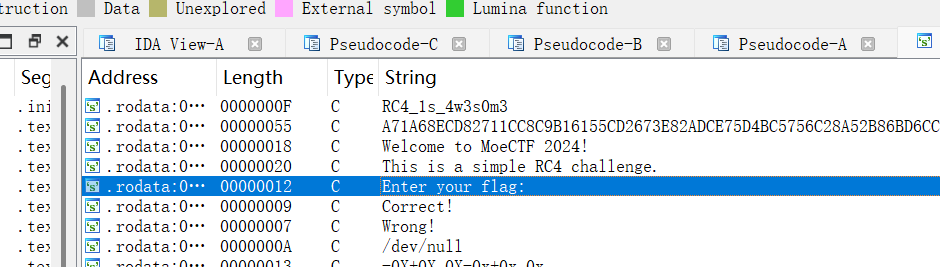
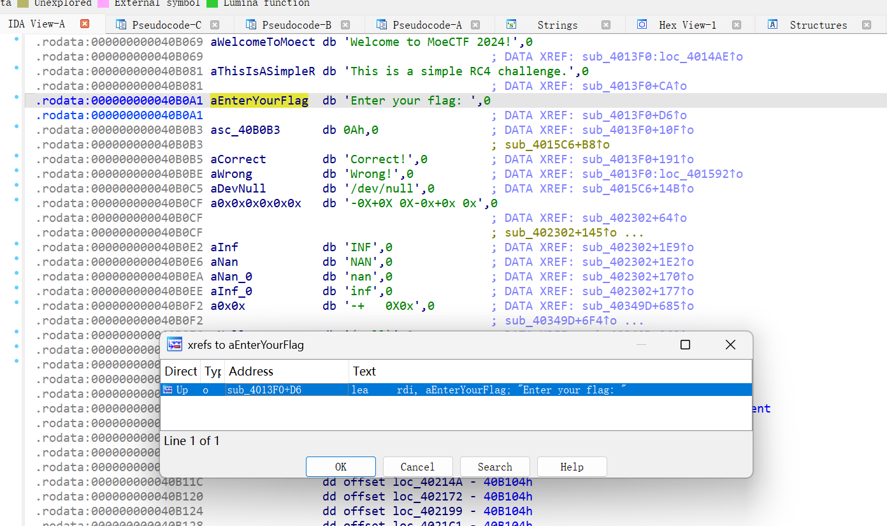
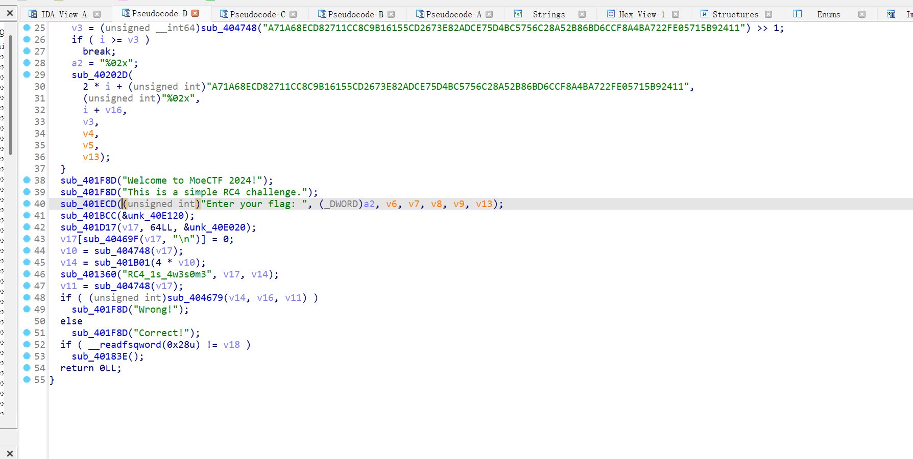
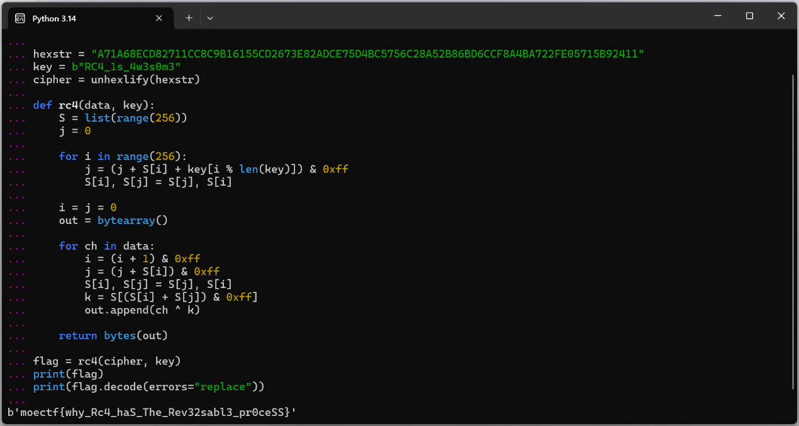

# rc4

| | |
|---|---|
| **Event** | MoeCTF 2024 |
| **Category** | Reverse engineering — RC4 |
| **Flag** | `moectf{why_Rc4_haS_The_Rev32sabl3_pr0ceSS}` |

## Overview

A Windows binary that validates the input using RC4.

## Solution

### 1. Find the real entry point

Opening the file in IDA and pressing `F5` initially shows nothing useful — IDA lands in a stub and the function list has no obvious `main`.



### 2. Enumerate strings

`Shift+F12` opens the string window. One string stands out:

```
enter the flag
```


Next to it is a value that looks like a key or password.



### 3. Follow the cross-references

Double-clicking `enter the flag` jumps to the data, and pressing `X` lists the cross-references. Accepting the reference lands in the real validation function.




### 4. Decrypt

The routine decrypts a hex-encoded blob. Reversing the XOR against the recovered key gives the plaintext:



```
moectf{why_Rc4_haS_The_Rev32sabl3_pr0ceSS}
```

## Takeaways

- When `F5` appears to show "no main", the program's real logic is often reachable only through string cross-references.
- `Shift+F12` + `X` is the fastest path from a user-visible message to the code that handles it.
- RC4 itself is symmetric: the same routine both encrypts and decrypts, which is why the binary can check the input in place.
