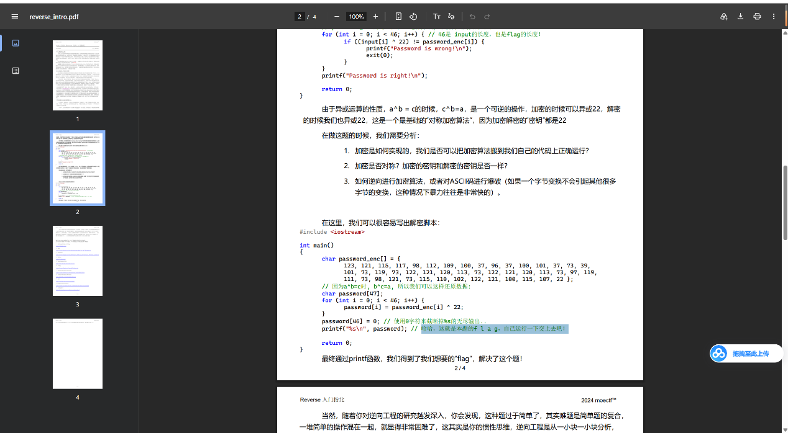
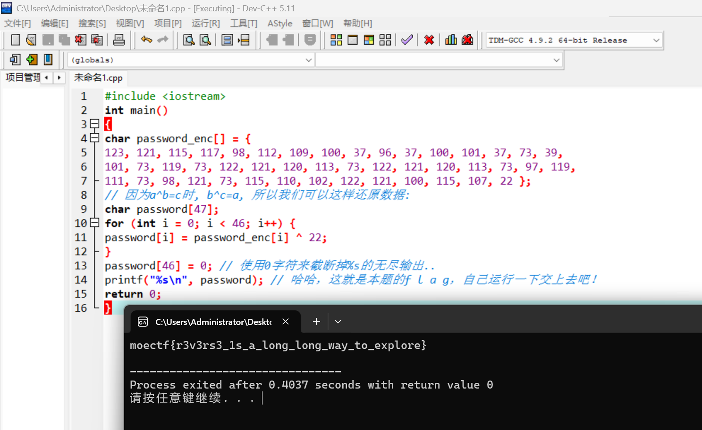

# Reverse Engineering Primer

| | |
|---|---|
| **Event** | MoeCTF 2024 |
| **Category** | Reverse engineering |
| **Flag** | `moectf{r3v3rs3_1s_a_long_long_way_to_explore}` |

## Overview

The attachment is a PDF containing the source code of a small C program.



## Solution

The PDF is not just documentation — it contains a complete program. Rather than reading the logic by hand, I copied the code into Dev-C++, compiled it with `F11`, and ran it.



The program prints the flag directly:

```
moectf{r3v3rs3_1s_a_long_long_way_to_explore}
```

## Takeaways

- Not every Reverse challenge ships a binary; if the source is provided, running it is often faster than analysing it.
- Copying code out of a PDF is error-prone — compile early so that syntax problems surface before you reason about the algorithm.
