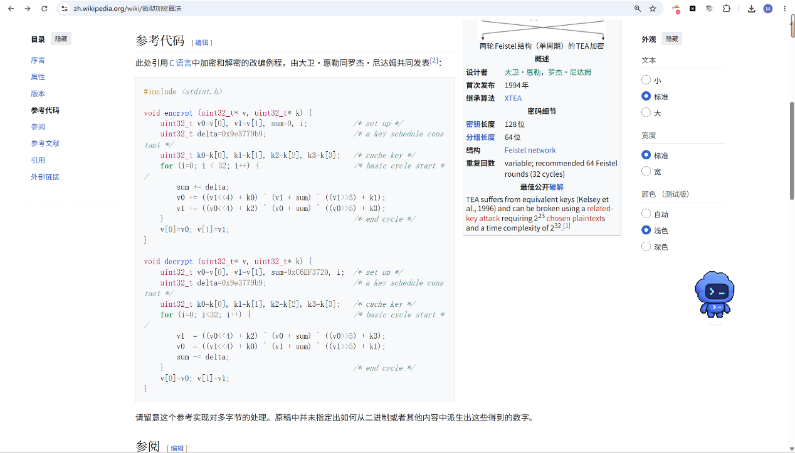
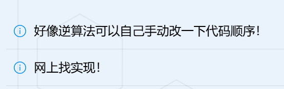
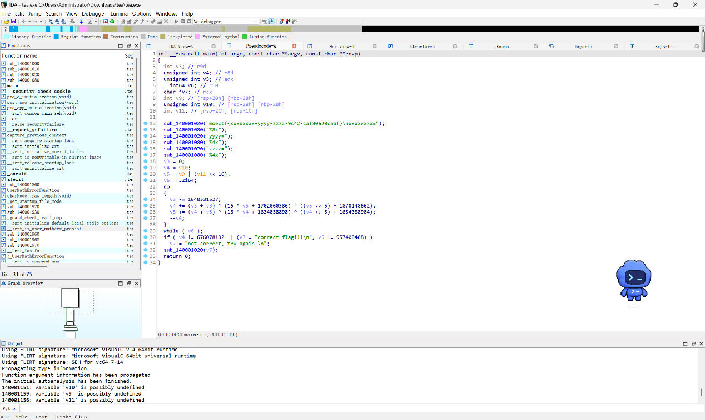

# TEA

| | |
|---|---|
| **Event** | MoeCTF 2024 |
| **Category** | Reverse engineering — TEA |
| **Flag** | Not recovered in the source notes |

## Overview

A binary implementing a TEA-family cipher. The challenge description links to the Wikipedia article on **TEA (Tiny Encryption Algorithm)**.



## Analysis

TEA is compact but not trivial: it mixes 32-bit words with additions, XORs and shifts over a fixed number of rounds. The hint suggests writing a decryption script rather than trying to invert the operations by hand.



Decompiling the binary with `F5` shows the round function:

```c
v3 = 1640531527;
do {
    v4 = (v3 + v6) ^ (16 * v6 + 1782063886) ^ ((v6 >> 5) + 1870148652);
    v4 = (v4 + v3) ^ (16 * v4 + 1634838599) ^ ((v4 >> 5) + 1634838599);
    --v6;
} while (v6);

if (v4 == 876078132 || v7 == "correct flag!!\n", v5 == 957400408)
    // ...
```



The constants `1640531527` (`0x61C88647`, the negation of the TEA delta `0x9E3779B9`), the `<< 4` / `>> 5` shifts and the per-round additions are the standard TEA structure with a custom key schedule.

## Status

The original notes stop after reading the decompiled source; the decryption script and flag are not recorded. Recovering the flag would require implementing the inverse rounds (subtract the delta, undo the shift/XOR mixing in reverse order) and matching the two output checks shown above.

## Takeaways

- Recognising the delta constant `0x9E3779B9` (or its negation) is usually enough to identify a TEA-family cipher.
- Write the decryption as the exact inverse of the round loop rather than trying to solve the equations symbolically.
