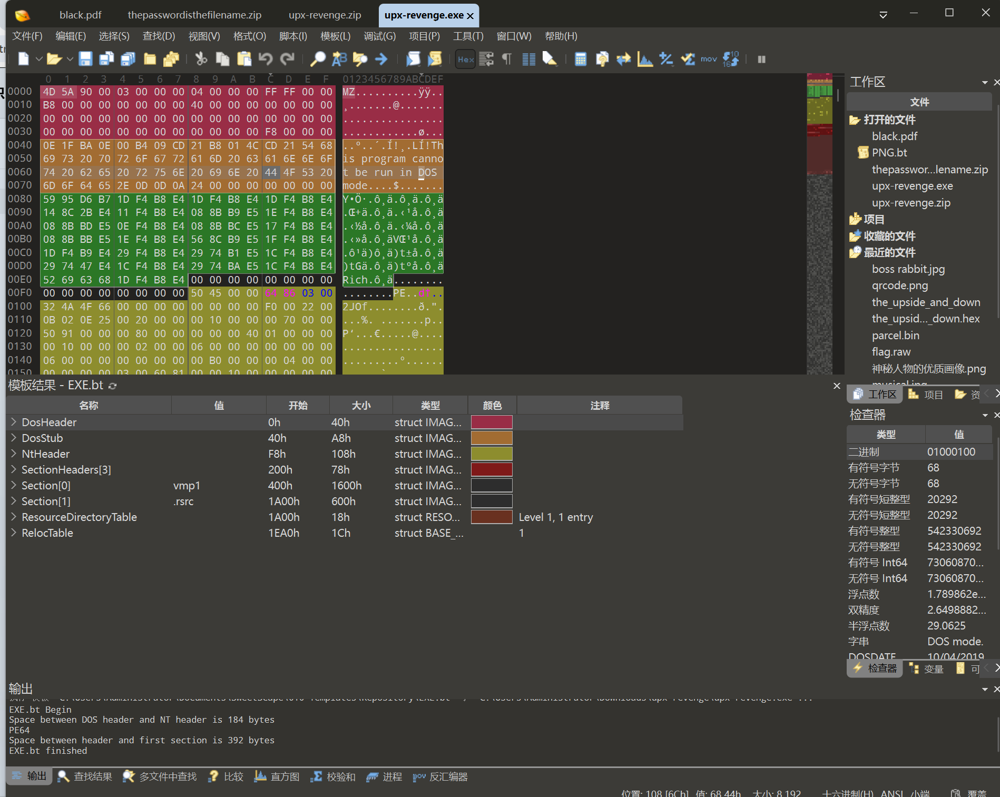
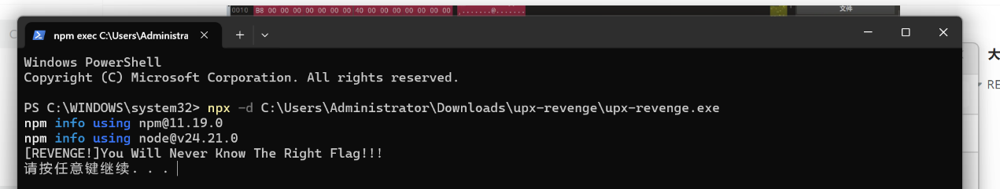
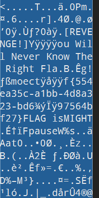
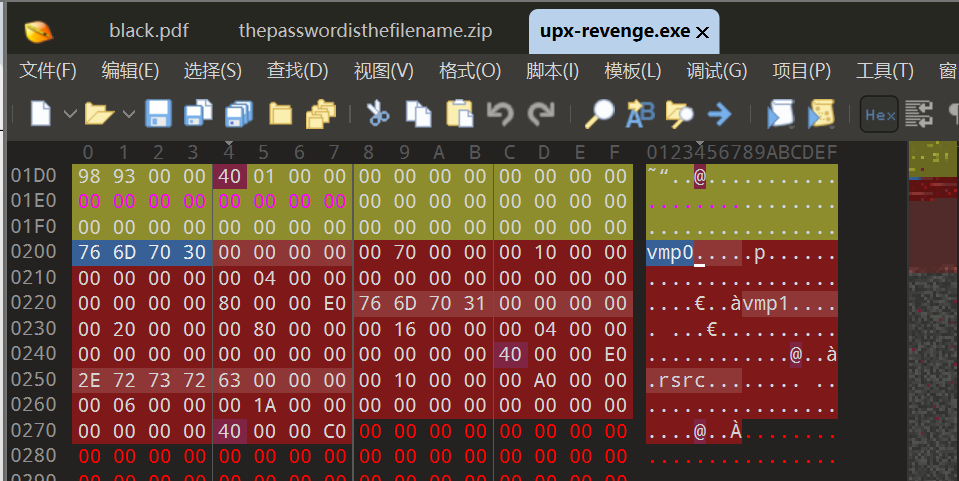
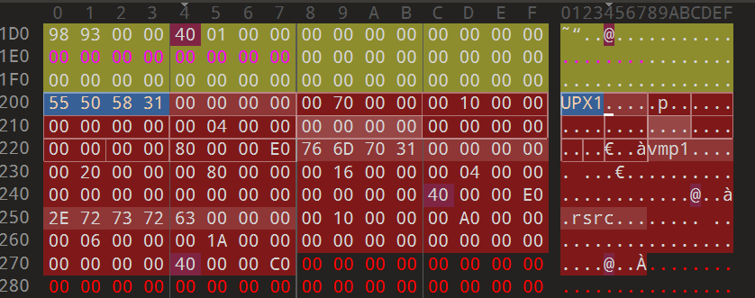
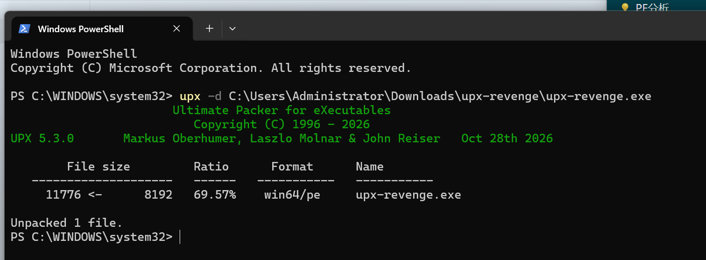
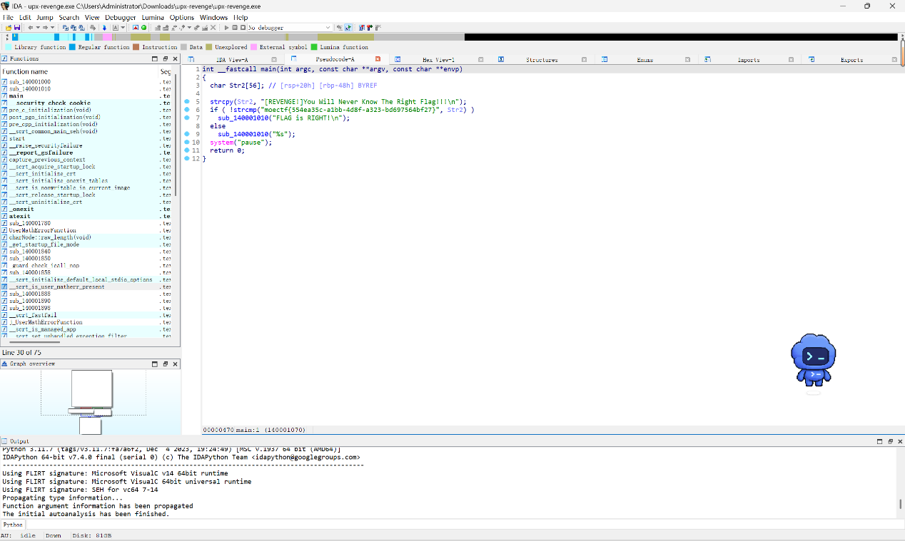
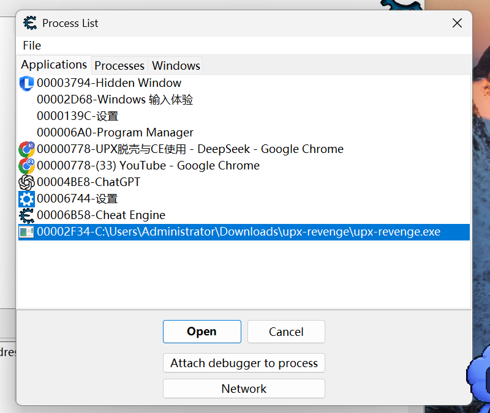

# upx-revenge

| | |
|---|---|
| **Event** | MoeCTF 2024 |
| **Category** | Reverse engineering — unpacking |
| **Flag** | `moectf{554ea35c-a1bb-4d8f-a323-bd697564bf27}` |

## Overview

The sequel to `upx`. This time the binary has been deliberately damaged so that standard unpacking tools refuse to recognise it.


## Solution

### 1. Inspect the binary

Opening it in 010 Editor shows the normal DOS stub message:

```
This program cannot be run in DOS mode.
```



The hint mentions `npx` (a typo for `upx`), so I tried unpacking it directly.



That fails: the tool cannot identify the file as a UPX-packed binary, because the header has been modified.

### 2. Look for the real signature

In 010 Editor, the file clearly contains UPX data near the end — the string `UPX1` is present, even though the normal UPX header magic has been altered.





Restoring the correct UPX header (the `UPX!` magic) lets the unpacker recognise the file again.



### 3. Unpack and decompile

```bash
upx -d challenge.exe
```

The unpacked binary loads cleanly into IDA; `F5` decompiles it and the flag is visible.



```
moectf{554ea35c-a1bb-4d8f-a323-bd697564bf27}
```

## Notes

The original notes mention that a second solution path exists (the final screenshot in the log) but do not describe it.



## Takeaways

- Corrupting the packer's magic bytes is a common way to defeat automated unpacking; the payload is still there, so look for `UPX1`/`UPX!` strings and repair the header.
- A packer check that reports "not packed" is not proof — confirm with the raw bytes.
