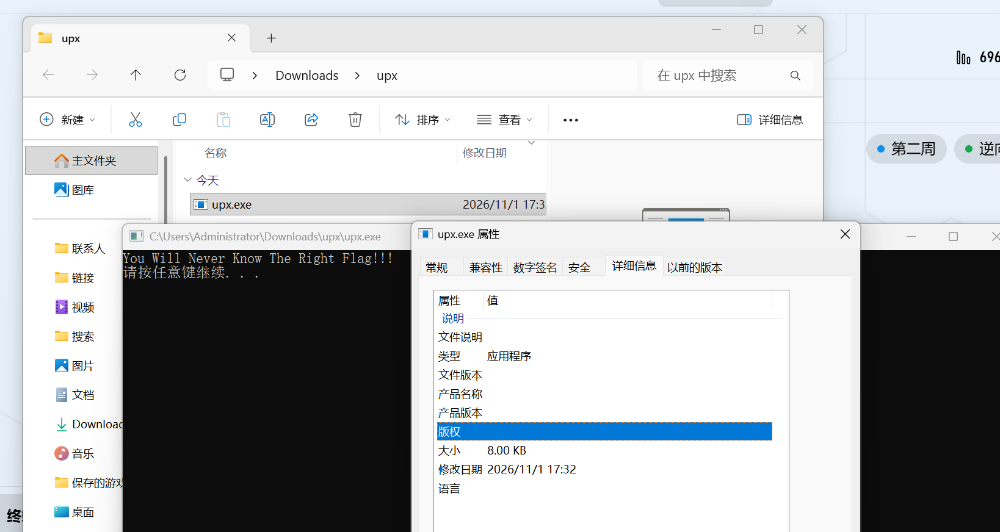
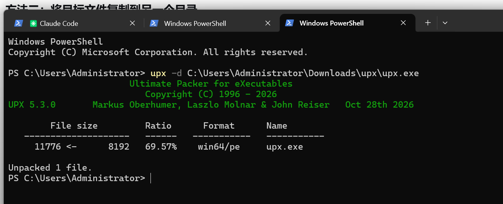
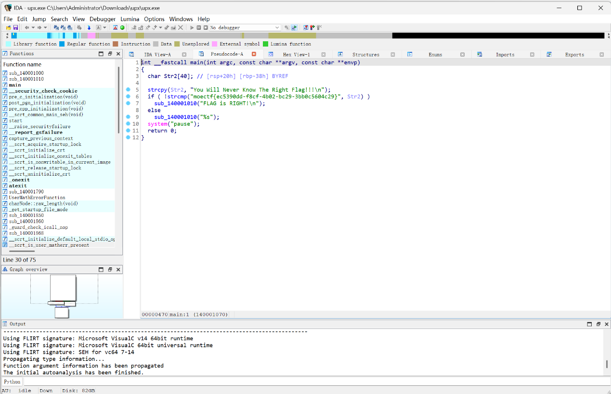
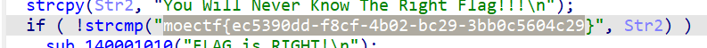

# upx

| | |
|---|---|
| **Event** | MoeCTF 2024 |
| **Category** | Reverse engineering — unpacking |
| **Flag** | `moectf{ec5390dd-f8cf-4b02-bc29-3bb0c5604c29}` |

## Overview

The attachment is a Windows executable that looks unremarkable at first. The challenge hint explicitly says to use **UPX**.



## Solution

### 1. Unpack

```bash
upx -d challenge.exe
```



### 2. Verify and decompile

After unpacking, a packer check confirms the file is now a normal executable. Loading it into IDA64 and pressing `F5` decompiles it.



The decompiled logic references the flag string directly.



```
moectf{ec5390dd-f8cf-4b02-bc29-3bb0c5604c29}
```

## Takeaways

- UPX leaves a recognisable signature; `upx -d` restores the original binary, after which normal static analysis works.
- Always unpack before decompiling — a packed binary produces meaningless pseudocode.
