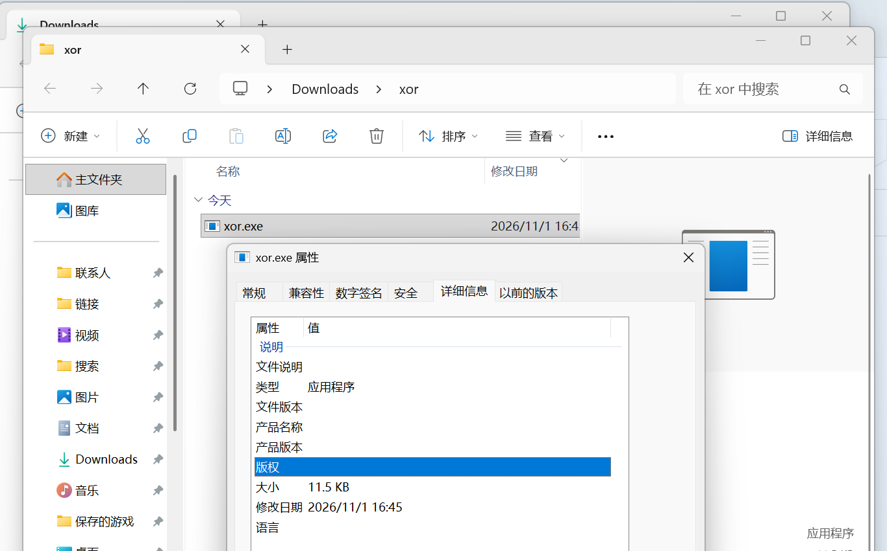
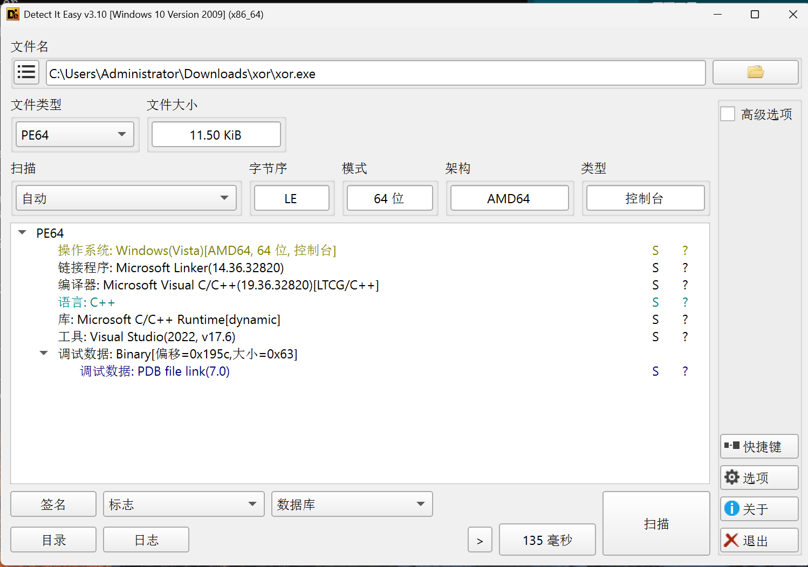
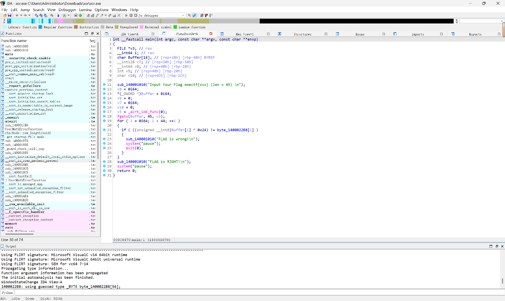
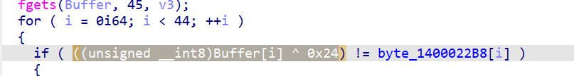
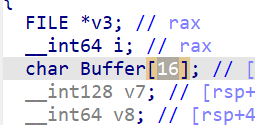
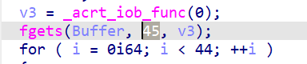
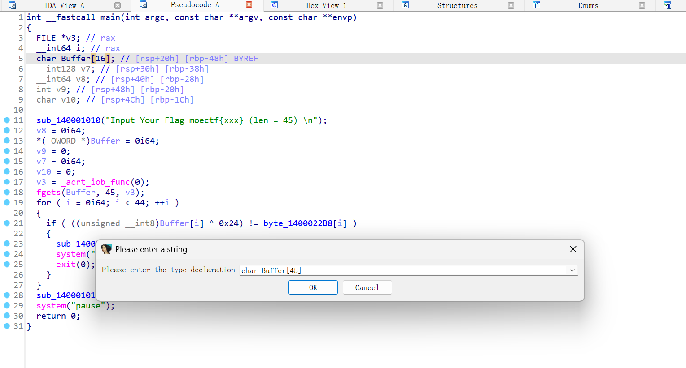
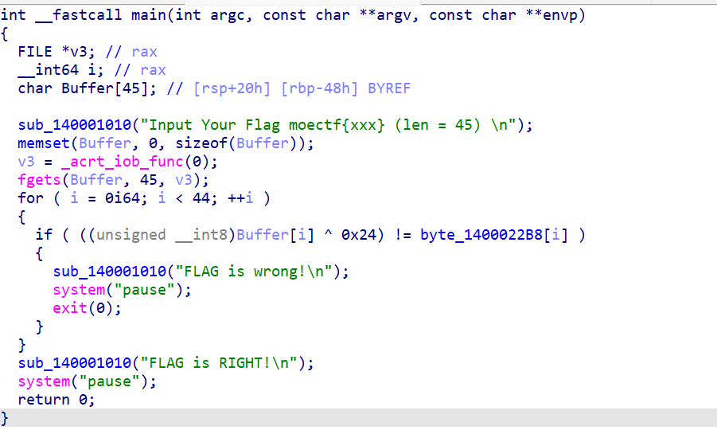
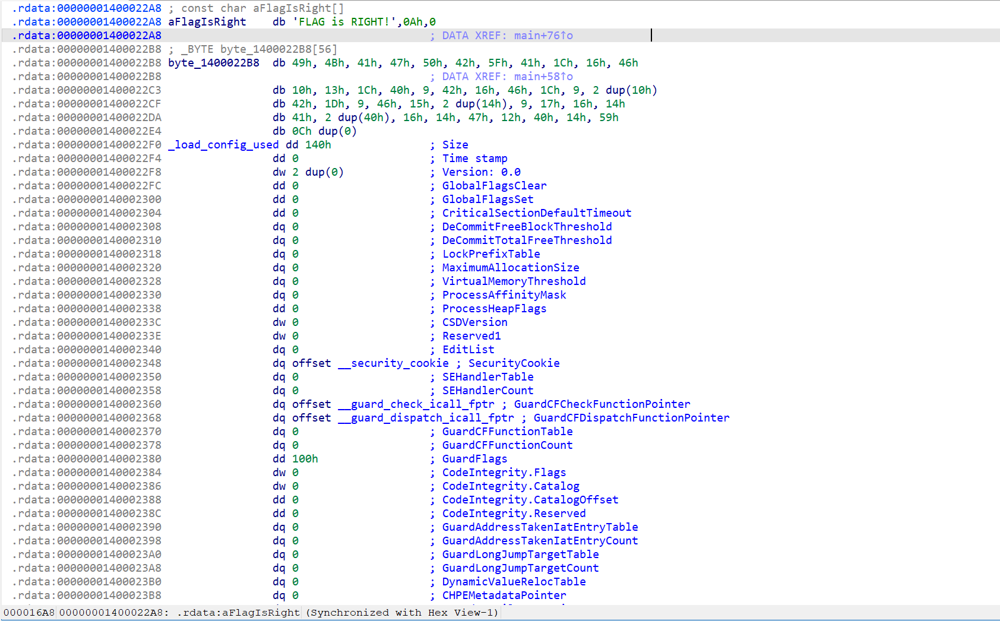
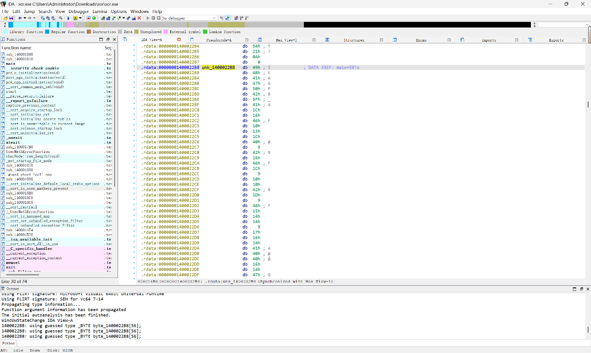

# Xor

| | |
|---|---|
| **Event** | MoeCTF 2024 |
| **Category** | Reverse engineering |
| **Flag** | `moectf{e82b478d-f2b8-44f9-b100-320edd20c6d0}` |

## Overview

A Windows executable that validates the input with a simple XOR routine.



## Solution

### 1. Check the binary

A quick packer check with Detect It Easy shows a normal MSVC build with no protector, so the binary can be loaded straight into IDA64.



### 2. Decompile

IDA's decompiler shows a small validation function built around an XOR encryption step.






The decompiler reported an error because it inferred the wrong type for the key buffer. Pressing `Y` on the variable and setting it to a `45`-byte array fixes the output.




The function runs a `for` loop with a branch and compares each decrypted byte against `byte_140002288[i]`.



Double-clicking `byte_140002288` jumps to the data, which IDA has not yet defined. Pressing `U` undefines it, and the bytes can then be read as the encrypted array.



### 3. Reverse the XOR

The ciphertext is only 44 bytes, so rather than writing an IDAPython script I extracted the array and reversed the XOR in C++. The key turned out to be a single byte, `0x24`:

```cpp
int enc[] = {
    0x49, 0x4B, 0x41, 0x47, 0x50, 0x42, 0x5F, 0x41,
    0x1C, 0x16, 0x46, 0x10, 0x13, 0x1C, 0x40, 0x09,
    0x42, 0x16, 0x46, 0x1C, 0x09, 0x10, 0x10, 0x42,
    0x1D, 0x09, 0x46, 0x15, 0x14, 0x14, 0x09, 0x17,
    0x16, 0x14, 0x41, 0x40, 0x40, 0x16, 0x14, 0x47,
    0x12, 0x40, 0x14, 0x59
};

for (int i = 0; i < (int)(sizeof(enc) / sizeof(enc[0])); ++i)
    std::cout << static_cast<char>(enc[i] ^ 0x24);
```

The resulting plaintext is the flag:

```
moectf{e82b478d-f2b8-44f9-b100-320edd20c6d0}
```

## Takeaways

- A decompiler type error often hides a simple array; fixing the variable type (`Y`) usually restores readable code.
- If IDA shows an address instead of data, `U` (undefine) followed by re-typing turns it into an array you can inspect.
- XOR with a short key is trivial to invert; there is no need for a solver when the ciphertext is this small.
