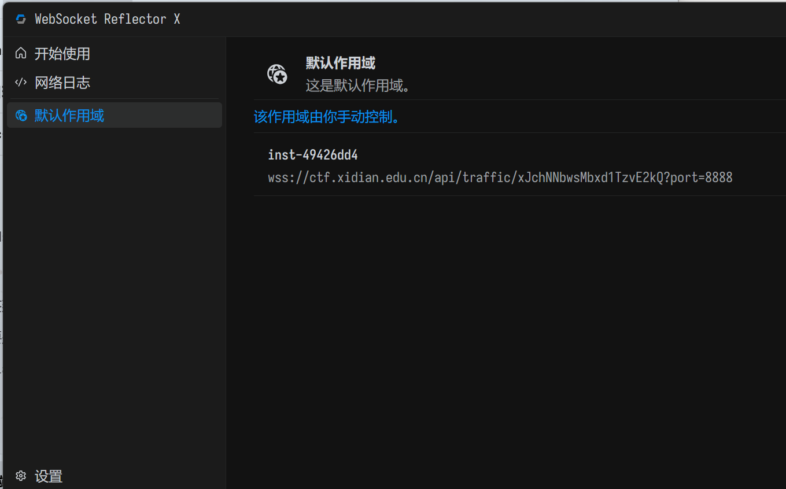
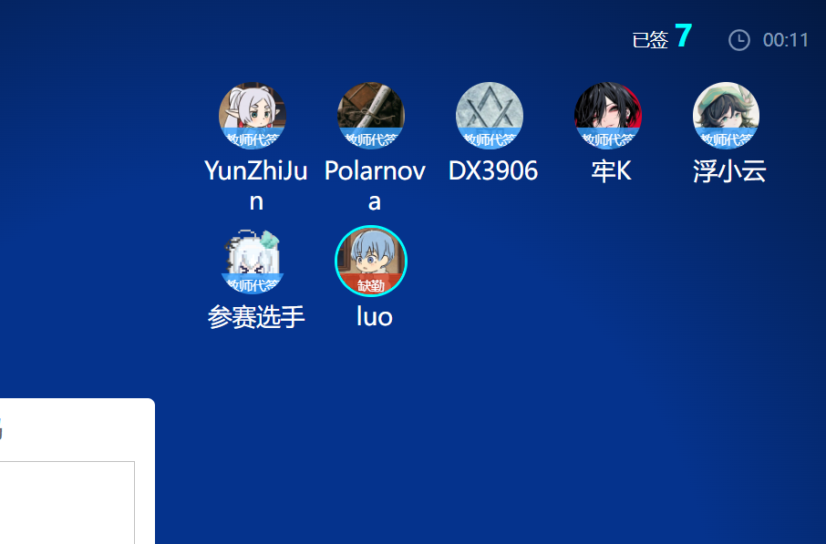
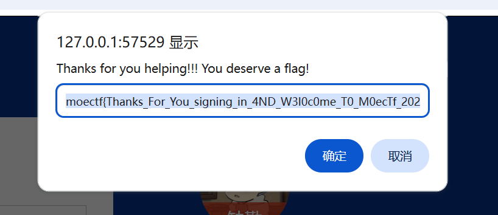

# Sign In

| | |
|---|---|
| **Event** | MoeCTF 2024 |
| **Category** | Web |
| **Flag** | `moectf{Thanks_For_You_signing_in_4ND_W3l0c0me_T0_M0ecTf_2024!!!}` |

## Overview

The challenge provides a web service behind a WebSocket tunnel. MoeCTF uses **WSRX** (WebSocket Reflector X) to expose per-player instances bound to `127.0.0.1`.

## Solution

1. Start the instance in WSRX. It maps the remote service to a local port, e.g. `127.0.0.1:<port>`.

   

2. Open the forwarded address in a browser. The page is a class sign-in sheet: seven participants have signed in, while **luo** is still marked absent.

   

3. The task is to complete the attendance sheet — mark `luo` as absent and sign in everyone else. Clicking through the remaining entries triggers the completion dialog:

   

```
moectf{Thanks_For_You_signing_in_4ND_W3l0c0me_T0_M0ecTf_2024!!!}
```

## Takeaways

- WSRX is the standard way to reach MoeCTF's per-player instances; each instance gets its own local port.
- The challenge is a pure client-side interaction task — read what the page state expects rather than looking for an injection point.
