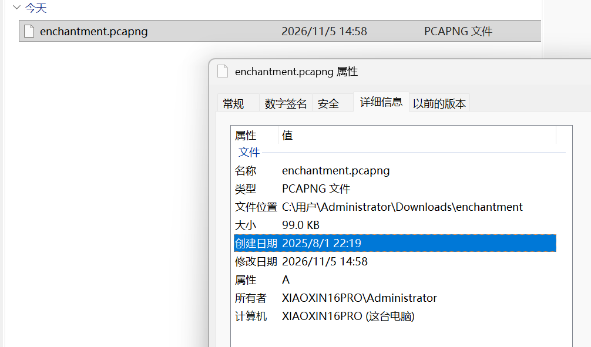
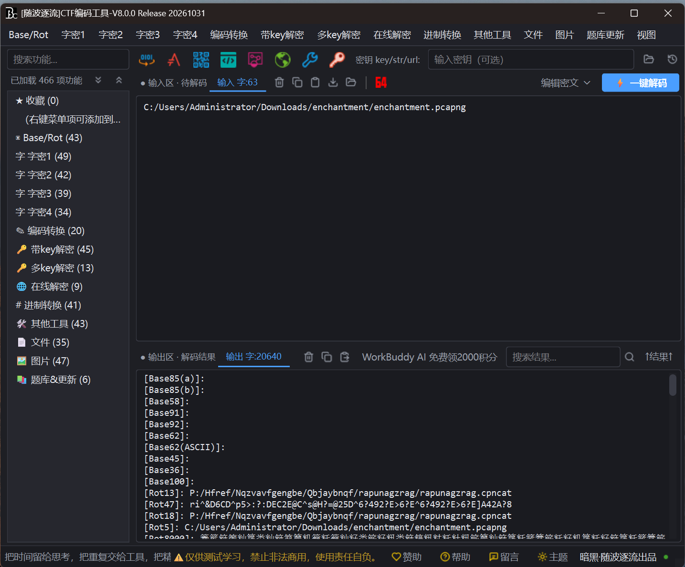
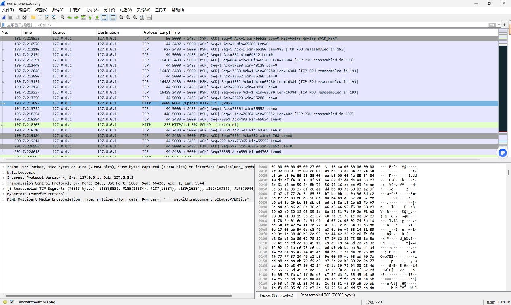

# Enchantment

| | |
|---|---|
| **Event** | MoeCTF 2025 |
| **Category** | Misc — network forensics (incomplete) |
| **Flag** | Not recovered in the source notes |

## Overview

The attachment initially looks like an ordinary file with nothing interesting in it. The original notes describe it as unremarkable until the file type was checked more carefully.

## Status

The material is not an image-steganography challenge as first assumed — it is a **packet capture**. The recorded traffic shows a PNG being uploaded, but the solve log stops at that observation.

No extraction step or flag was recorded, so this writeup is kept for completeness rather than as a solution reference.
