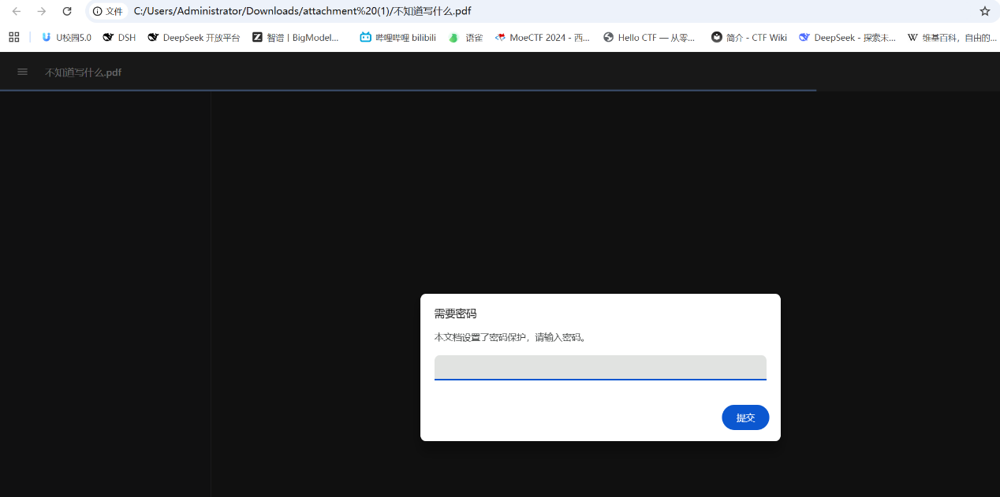
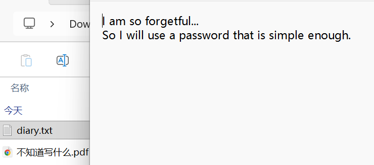
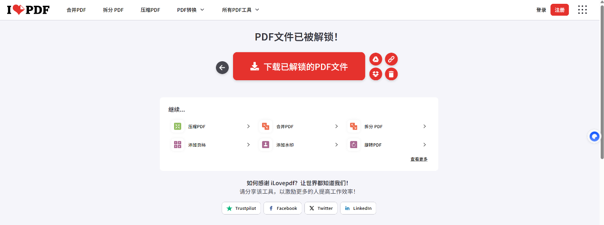
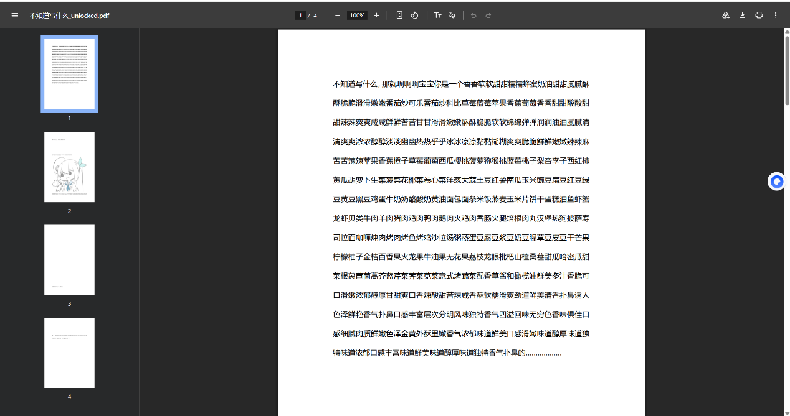
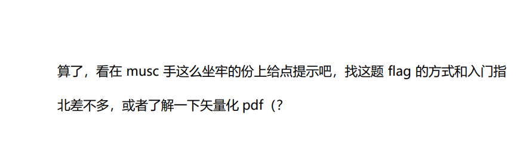
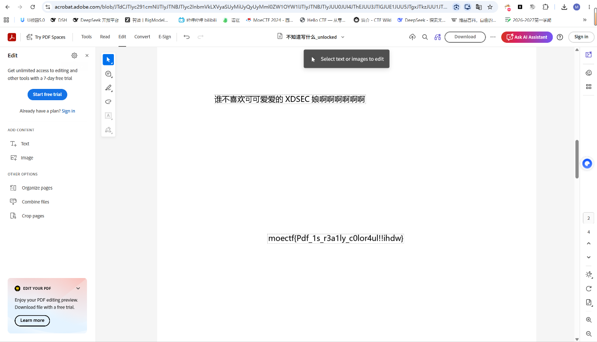

# encrypted_pdf

| | |
|---|---|
| **Event** | MoeCTF 2025 |
| **Category** | Misc — PDF password / layered content |
| **Flag** | `moectf{Pdf_1s_r3a1ly_c0lor4ul!!ihdw}` |

## Overview

The attachment is a PDF that asks for a password when opened. The challenge statement says the password is weak, and a file named `diary` is provided alongside it — apparently a password hint.



## Solution

Looking at `diary` did not reveal anything technical, so I treated it as the weak-password hint it was meant to be and used an online PDF password-recovery service. The password was recovered quickly.





The decrypted PDF contained a hint laid over the page.




Deleting the hint layer exposed the flag underneath — the challenge title's "colourful" is a nudge that the page has multiple layers rather than a single flat image.

```
moectf{Pdf_1s_r3a1ly_c0lor4ul!!ihdw}
```

## Takeaways

- A "weak password" challenge is a dictionary/brute-force problem, not a cryptanalysis one.
- After decrypting a PDF, inspect the content stream and layers; text and objects can be hidden behind opaque overlays.
