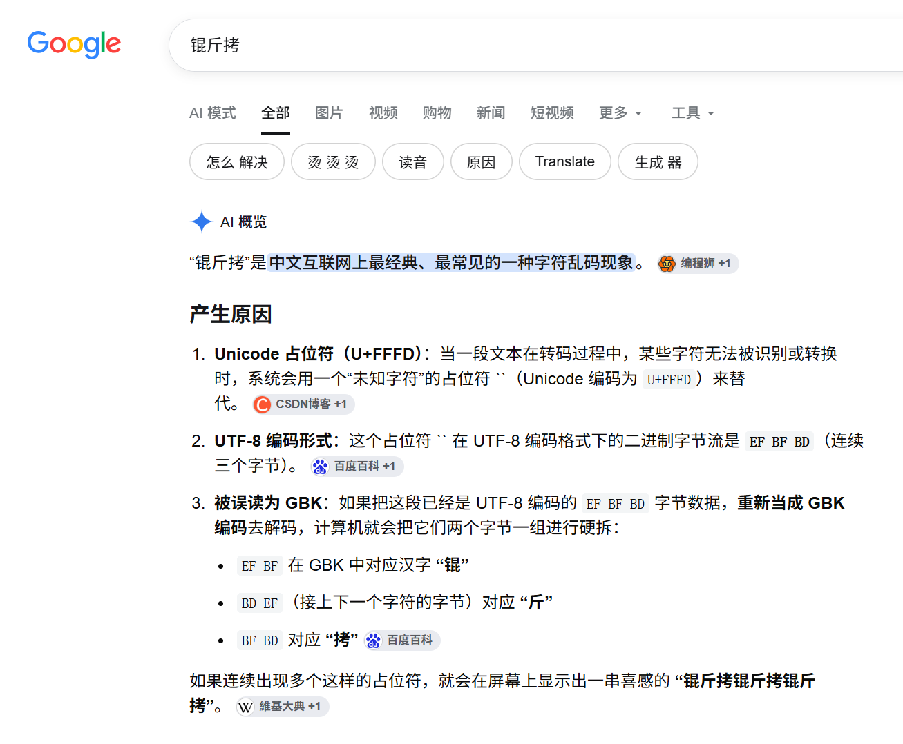

# ez_锟斤拷????

| | |
|---|---|
| **Event** | MoeCTF 2025 |
| **Category** | Misc — encoding / mojibake |
| **Flag** | `moectf{EnC0d1ing_gbK_@nD_Utf_8_1s_4un!!ewwww}` |

## Overview

The challenge name is already the hint: **锟斤拷** is what you see when UTF-8 bytes are decoded as GBK and then handled badly again — the classic Chinese mojibake marker.

## Solution

Searching the hint led to the same conclusion: the data has been encoded and decoded with mismatched character sets.

 Instead of trying to read the garbled text by eye, I ran it through CyberChef and tried the GBK / UTF-8 conversion pair until the bytes came back as readable text.

The recovered flag:

```
moectf{EnC0d1ing_gbK_@nD_Utf_8_1s_4un!!ewwww}
```

## Takeaways

- `锟斤拷` and `烫烫烫` are signatures of encoding mistakes, not random corruption.
- Encoding challenges are reversible: identify the byte-level transform (GBK vs UTF-8) and apply it in the right direction in CyberChef.
