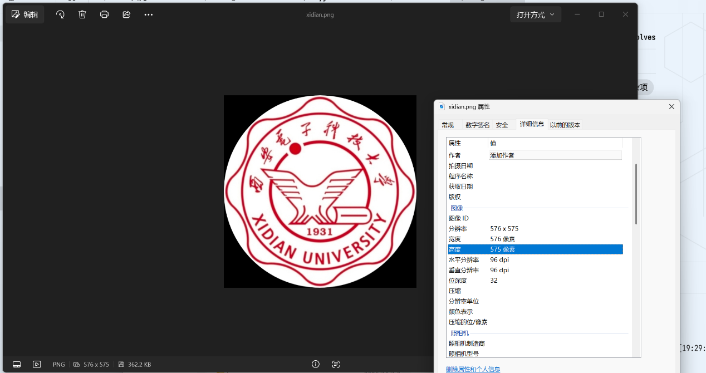
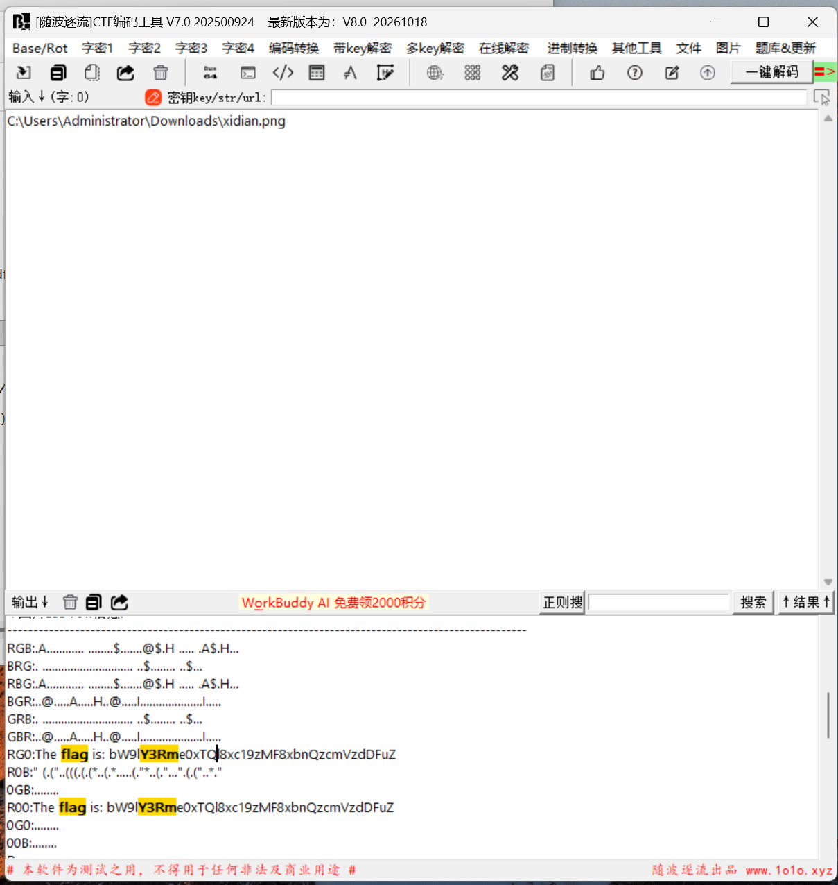
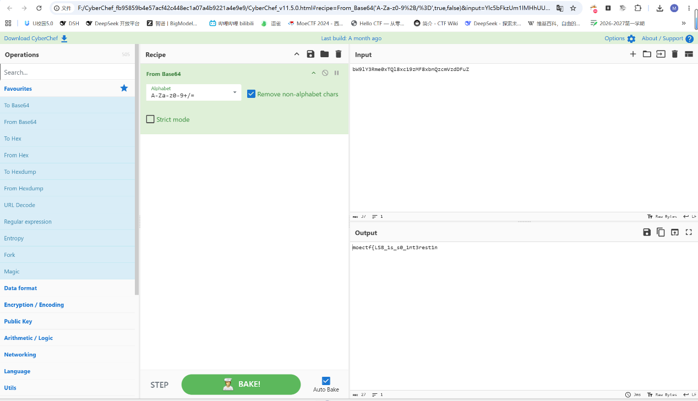
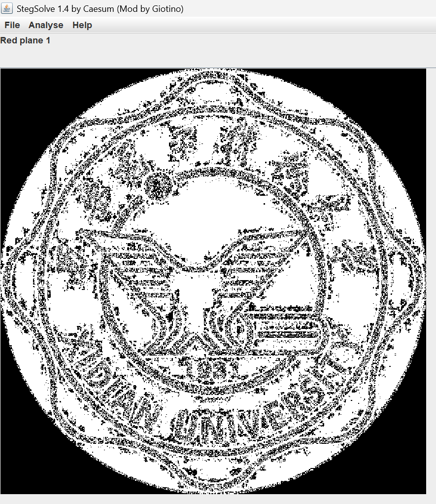
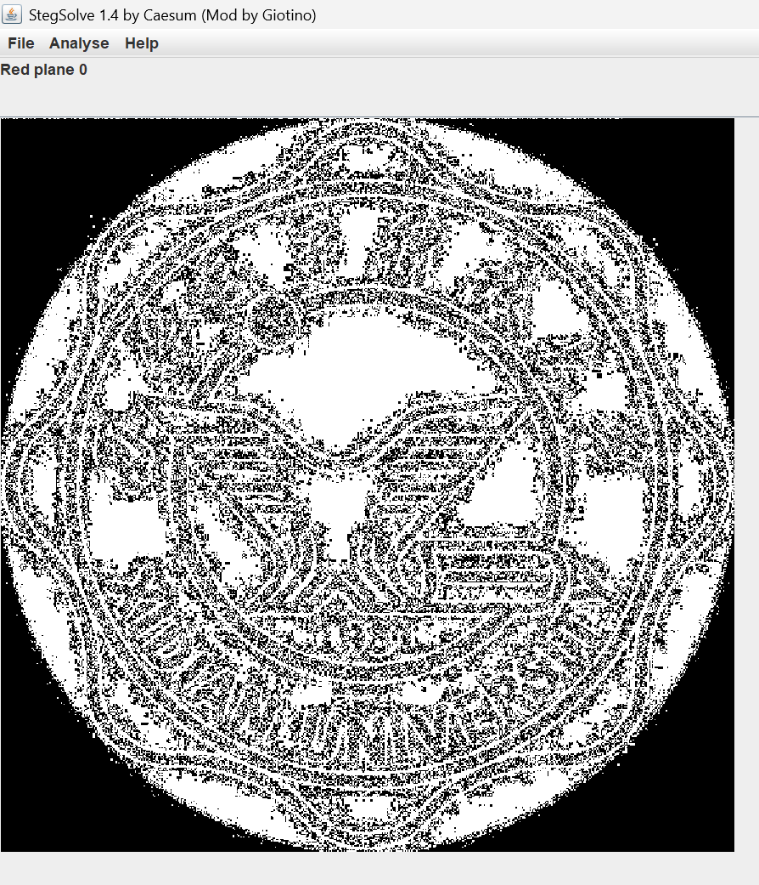
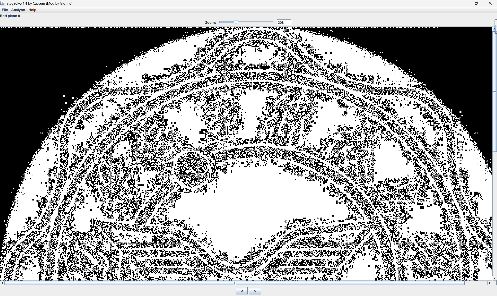
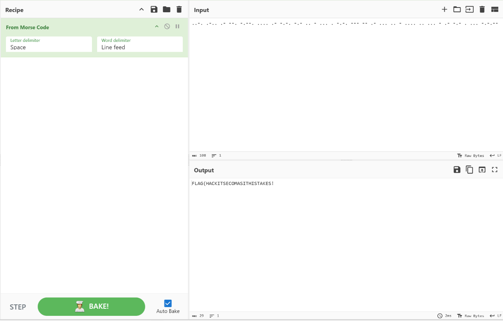
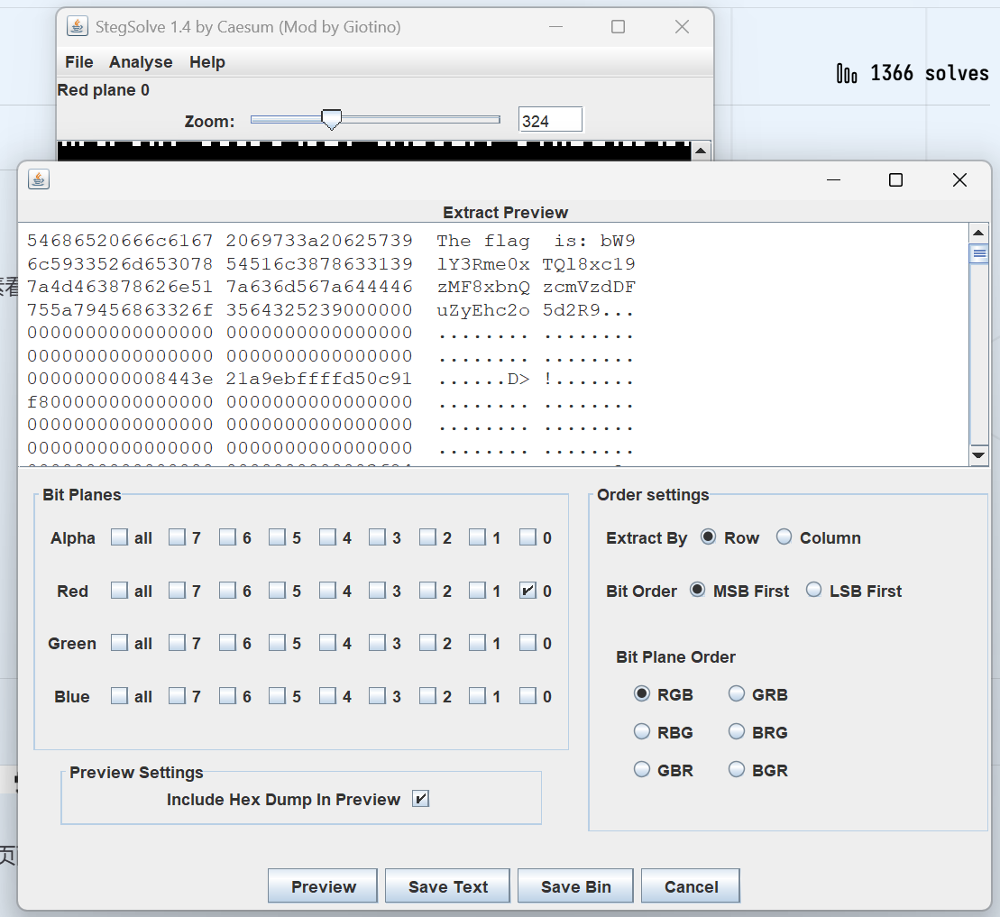
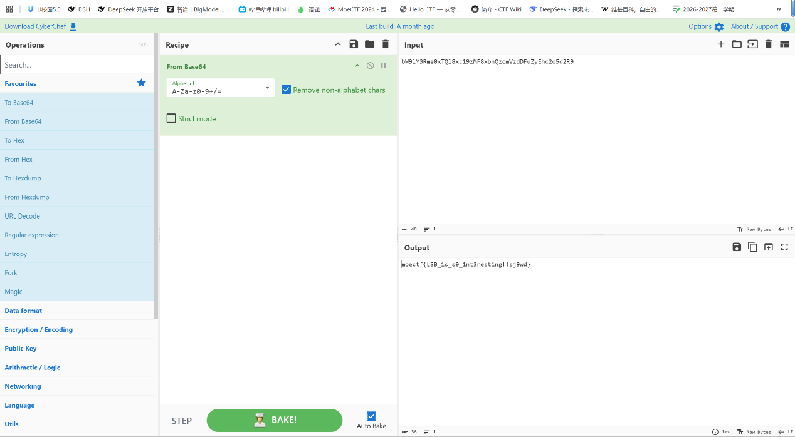

# ez_LSB

| | |
|---|---|
| **Event** | MoeCTF 2025 |
| **Category** | Misc — LSB / channel steganography |
| **Flag** | `moectf{LSB_1s_s0_1nt3rest1ng!!sj9wd}` |

## Overview

An image that looks ordinary. There is no obvious crop or appended archive, so the data is likely inside the pixel values.



## Solution

StegSolve across the colour channels showed nothing at first.



A Base64-looking string in the challenge material decoded to only half of a flag, which meant a second half was hidden somewhere.




Comparing the image against the original revealed an extra white edge in the **red channel** that should not be there.




Zooming into that edge showed what looked like Morse code; my first reading produced

```
flag{hackitsecomasithistakes}
```

which was rejected.




The Base64 string was the reliable path. Decoding

```
bW9lY3Rme0xTQl8xc19zMF8xbnQzcmVzdDFuZyEhc2o5d2R9
```

gave the complete flag:



```
moectf{LSB_1s_s0_1nt3rest1ng!!sj9wd}
```

## Takeaways

- A half-decoded flag is a hint that the data is split across carriers — keep looking instead of guessing the tail.
- Diff the image against a reference when one is available; a one-pixel white border is easy to miss at normal zoom.
- Morse readings from noise can look plausible and still be wrong; prefer a deterministic decode when one exists.
