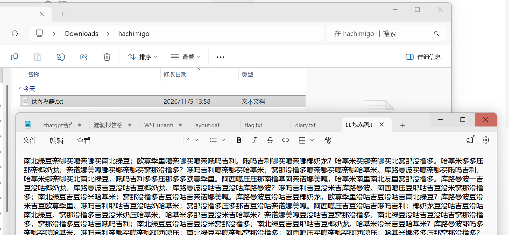
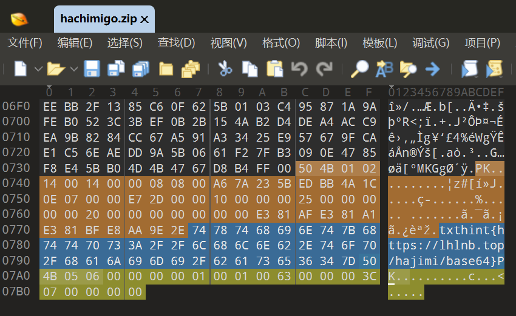
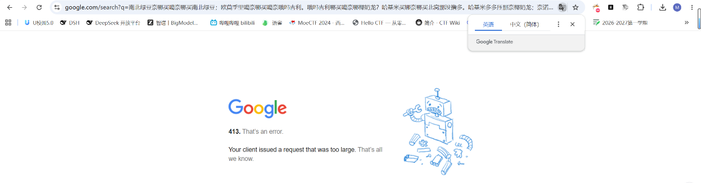
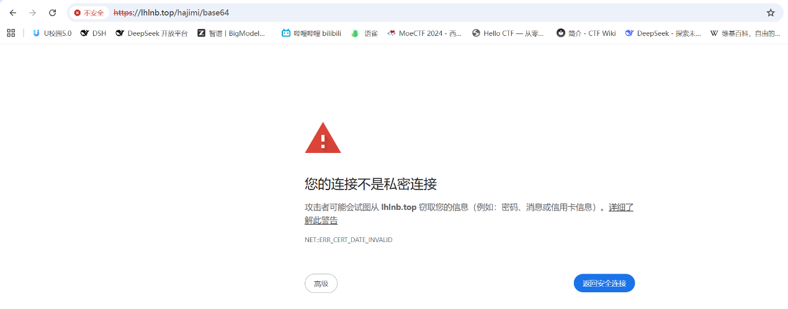
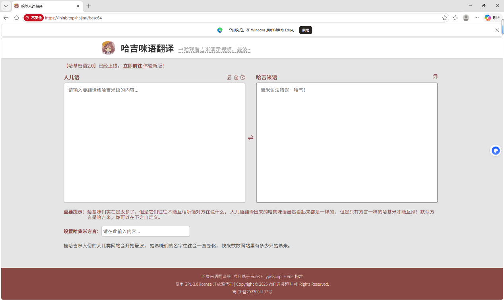
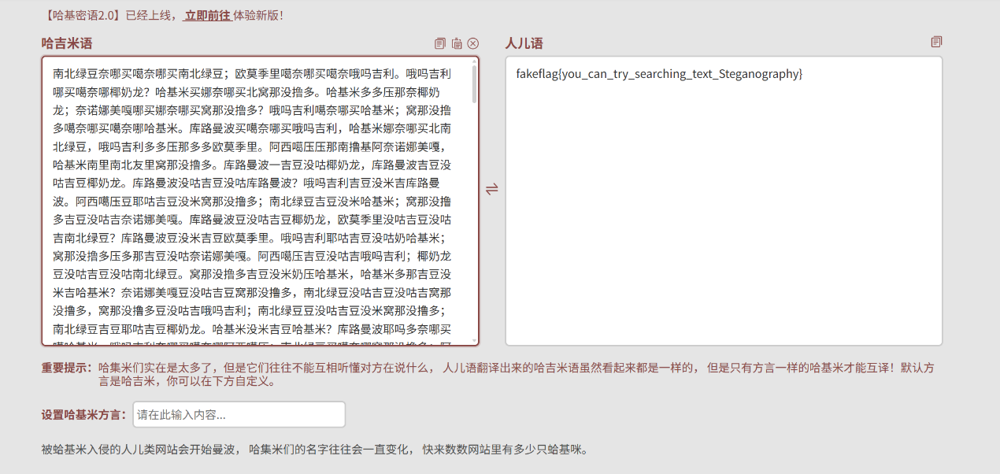
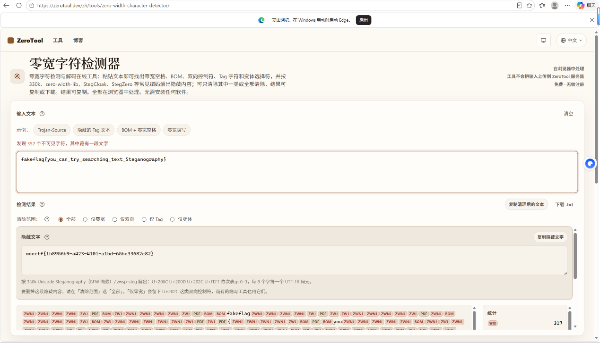

# 哈基米难没露躲

| | |
|---|---|
| **Event** | MoeCTF 2025 |
| **Category** | Misc — zero-width steganography |
| **Flag** | `moectf{1b8956b9-a423-4101-a1bd-65be33682c82}` |

## Overview

The attached image renders as visibly corrupted — the challenge title is a joke about the author having eaten a hallucinogenic mushroom. The corruption is the first clue that the file is more than an image.



## Solution

Opening the file in 010 Editor revealed an embedded hint string:




```
txthint{https://lhlnb.top/hajimi/base64}
```

Searching for the URL was not useful (the search engine was failing at the time), and it quickly became clear that this was not asking us to open a web page.



Treating it as a Base64 or URL-encoding instruction in CyberChef did not produce anything meaningful either.



The hint was pointing at the encoding family, not at a remote payload. The text itself contains invisible zero-width characters, so a normal Base64 decode sees only the visible glyphs.



Using an online zero-width steganography decoder extracted the hidden message immediately.



```
moectf{1b8956b9-a423-4101-a1bd-65be33682c82}
```

## Takeaways

- Text that looks empty or oddly spaced may be carrying zero-width characters — inspect the code points, not the glyphs.
- A hint containing a URL is not always an instruction to fetch it; read what the path or filename is telling you.
