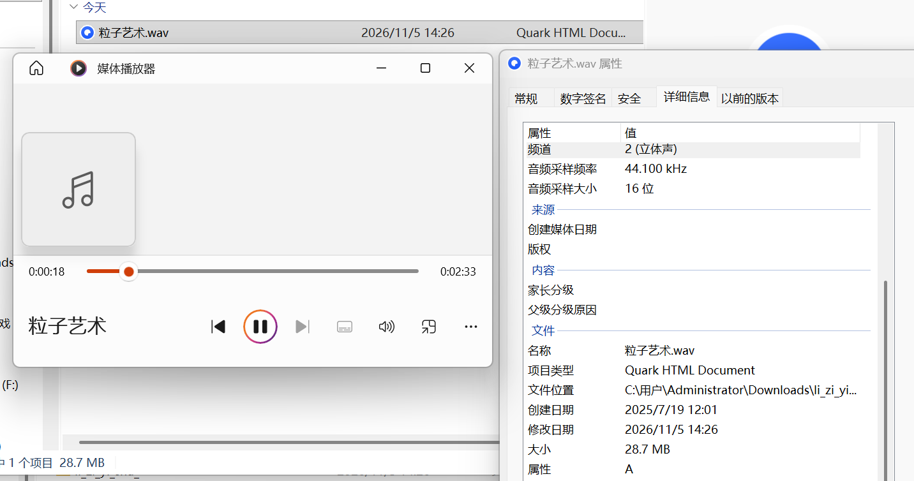
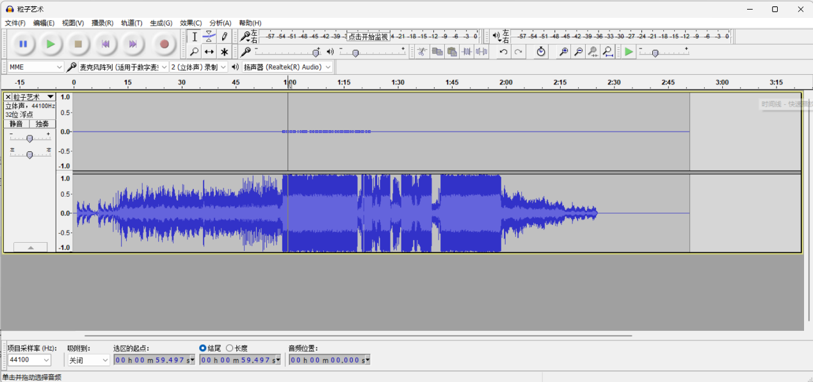
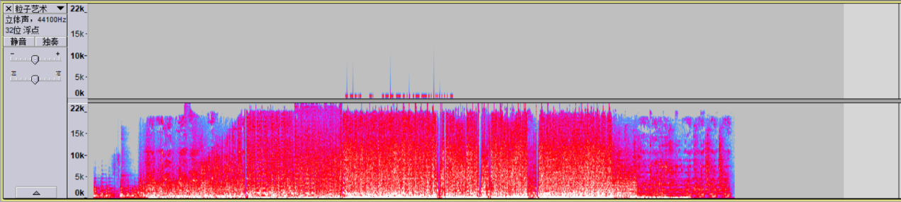
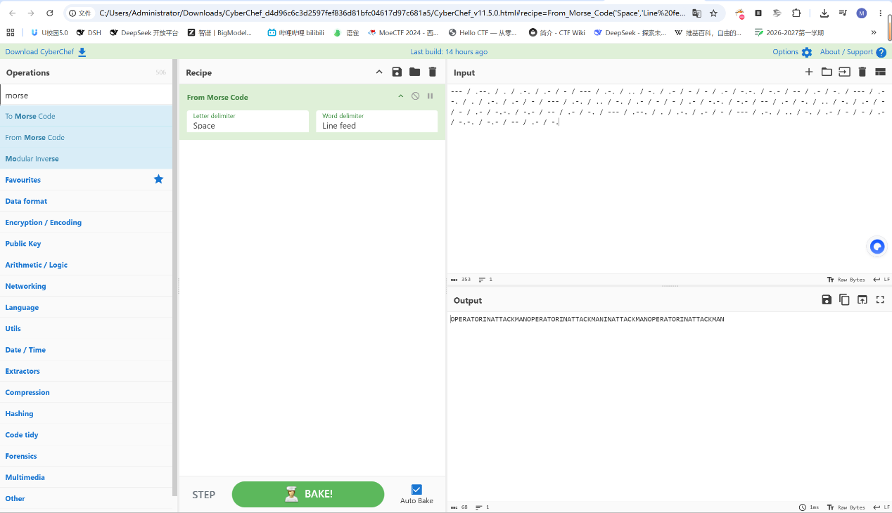
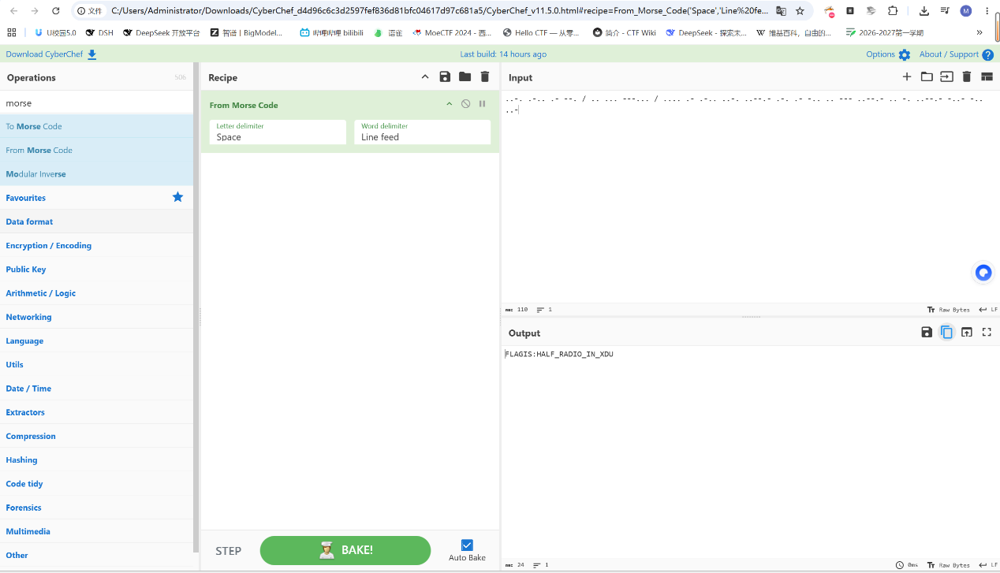

# 捂住一只耳 (Hold One Ear)

| | |
|---|---|
| **Event** | MoeCTF 2025 |
| **Category** | Misc — audio steganography / Morse code |
| **Flag** | `moectf{HALF_RADIO_IN_XDU}` |

## Overview

The attachment is an audio file. The title — "cover one ear" — is the hint: the two channels do not carry the same content. Listening normally only plays the obvious right channel.



## Solution

I separated the channels and found that the right channel is the ordinary audio track, while the left channel contains Morse code with the cadence of an old telegraph.




My first decode of the left channel produced:

```
--- / .--. / . / .-. / .- / - / --- / .-. / .. / -. / .- / - / - / .- / -.-. / -.- / -- / .- / -.
```

which reads `OPERATOR IN ATTACK MAN`. That is a coherent phrase but not a flag, so I had read the wrong section of the track.



Continuing through the channel, the actual message appeared:

```
..-. .-.. .- --. / .. ... ---... / .... .- .-.. ..-. ..--.- .-. .- -.. .. --- ..--.- .. -. ..--.- -..- -.. ..-
```

Decoding it gives:



```
FLAG IS: HALF_RADIO_IN_XDU
```

so the flag is:

```
moectf{HALF_RADIO_IN_XDU}
```

## Takeaways

- For stereo audio, always check each channel separately; a channel can sound empty while carrying data.
- Morse decoders happily return plausible words from the wrong segment of a recording — validate the result before submitting it.
- The challenge name is often the only hint you need: "cover one ear" literally means "listen to one channel".
