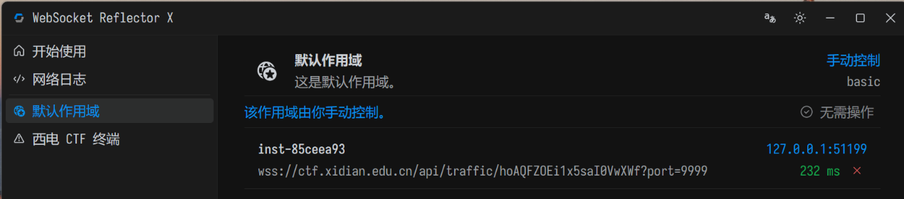
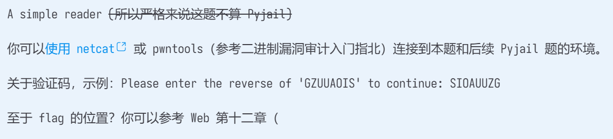
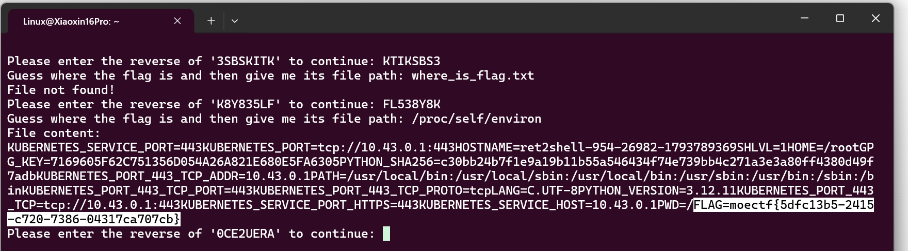

# Pyjail 0

| | |
|---|---|
| **Event** | MoeCTF 2025 |
| **Category** | Misc — Python jail |
| **Flag** | `moectf{5dfc13b5-2415-c720-7386-04317ca707cb}` |

## Overview

A Python jail served over the network. The challenge page provides an instance; after starting it, the hint is simply to connect with `nc`.




## Solution

I connected to the instance with `nc` and inspected the environment the jail was running in.



The flag was present as an environment variable, so no sandbox escape was needed — reading the process environment was enough.

```
moectf{5dfc13b5-2415-c720-7386-04317ca707cb}
```

## Takeaways

- Before attacking a Python jail's filters, check what the process already exposes: environment variables, globals, and loaded modules are often enough.
- In CTF deployments the flag is frequently injected through the environment rather than embedded in a file.
