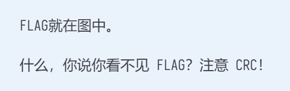
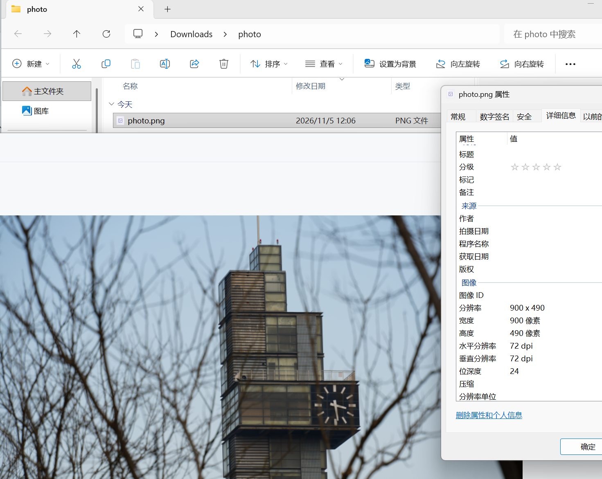
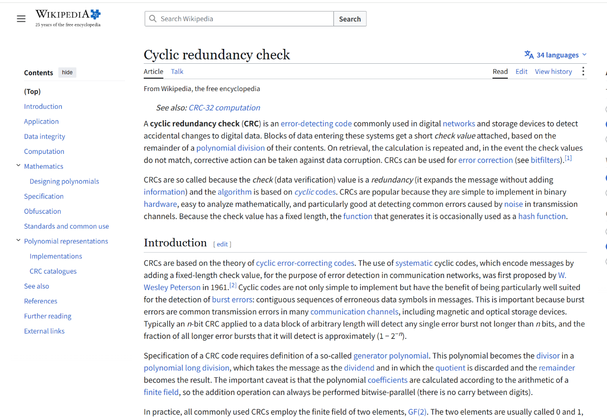
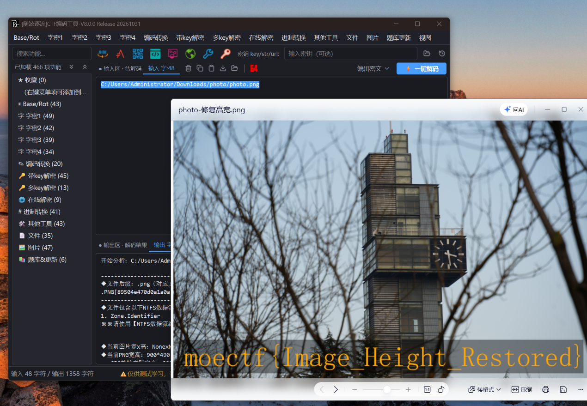
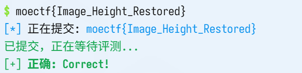

# weird_photo

| | |
|---|---|
| **Event** | MoeCTF 2025 |
| **Category** | Misc — PNG structure / height restoration |
| **Flag** | `moectf{Image_Height_Restored}` |

## Overview

The attachment is a photo that opens without complaint but appears to contain nothing unusual. The challenge hint points at the PNG format specification.



## Solution

I opened the file and checked its properties and embedded metadata first; there was nothing useful.



The hint links to the PNG specification, which was not obvious to me at first — this challenge is about the image header rather than the pixels.



A PNG starts with an `IHDR` chunk that stores the width and height, followed by a CRC over that chunk. If the stored height is smaller than the real image data, viewers render only the visible part and silently ignore the rest; the CRC no longer matches, but many tools do not complain.

The image looked complete at its rendered size, and nothing in the visible pixels suggested hidden data.



Rather than hand-editing the header, I ran the file through 随波逐流 (a Chinese stego toolbox), which detected the inconsistent height and restored it. With the correct height the hidden lower part of the image became visible.



```
moectf{Image_Height_Restored}
```

## Takeaways

- "The image opens fine" does not mean the PNG is intact — check `IHDR` width/height against the CRC and the actual data length.
- Hiding content below a reduced height is a standard PNG trick; tools such as 随波逐流 automate the repair.
